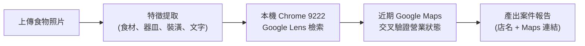

# 用照片尋找餐廳 (Food Guessr)

這個專案結合大語言模型、視覺多模態分析與本機自動化瀏覽器，能根據使用者上傳的餐點照片，找出最可能的餐廳店家，並透過 Google Maps 近期照片、菜單評論、地址與營業狀態進行嚴格的多重物證核對。

---

## 核心排查架構與流程

1. **物證觀察**：嚴格區分「客觀可見」與「推測」，聚焦於餐具紋路、配菜擺盤、裝潢風格與桌面文字。
2. **就地瀏覽器控制**：透過 `scripts/browser_controller.py` 連接本機 `Port 9222` AI 專用 Chrome，就地進行 Google Lens 多模態搜尋，不彈出多餘視窗。
3. **時效性與營業核查**：結合 Google Maps 近期（6～12 個月內）評論與照片，器皿或菜單明顯不符即行排除，避免將已歇業店家誤判為解答。

---

## 給 AI 的開始方式

若 AI 具備自動讀取專案指引的能力，請先閱讀根目錄的 `AGENTS.md` 和 `找餐廳判斷規則.md`。之後使用者只要上傳餐點或店內照片，即自動開始餐廳辨識。

若 AI 不會自動讀取專案檔案，可在對話中貼上以下任務說明，並附上照片：

> 請依此專案的 `找餐廳判斷規則.md` 分析我附上的照片，辨認最可能的餐廳。請先核對照片中的餐點、餐具、桌面與店內環境，再以圖片搜尋及 Google Maps 近期照片、評論、地址和目前營業狀態驗證。若我沒有指定日期，預設找目前仍營業的店；若地點未指定，使用規則中的預設搜尋範圍，必要時擴大並註明。請把本次照片建成獨立案件，記下我的後續更正與已排除店家。結論必須提供店名及可開啟的 Google Maps 地點連結；證據不足時要明確說尚無法確認，不可猜成定論。

---

## 擴充生態與模組

本專案提供多種接入端與自動化擴充功能：

- **[Discord 美食偵探機器人 (discord_bot/)](discord_bot/README.md)**：
  專為 Discord 伺服器打造的美食偵探機器人，支援發圖 `@這哪家` 自動立案、群友搶答競猜，並與 Antigravity 本地端進行全自動新對話接軌調查。詳細安裝與操作請參閱 **[discord_bot/README.md](discord_bot/README.md)**。

---

## 專案檔案結構

- `AGENTS.md`：AI 接手本專案時的操作指引（含瀏覽器就地控制器與 30 分鐘時間控制規範）。
- `找餐廳判斷規則.md`：比對方法、進階破案技巧（局部裁切、微型物證提取、記憶偏差雙軌驗證）、查證標準和輸出格式。
- `scripts/browser_controller.py`：AI 專用 Chrome（`Port 9222`）就地控制與 Google Lens 多模態以圖搜尋 CLI 工具。
- `discord_bot/`：Discord 機器人獨立模組（[前往專屬說明文件](discord_bot/README.md)）。
- `案件/案件模板.md`：每張新照片／每個新辨識任務的紀錄模板。
- `案件/`：歷史辨識案件（如案件 001～009）的觀察、紀錄、照片與排除名單。
- `.agents/skills/security-audit/`：程式碼推送前資安與合規性自動化審查技能。

---

## 使用時的注意事項

- **個案獨立原則**：每張不同照片建立獨立新案件；新案件不得繼承舊案的菜色或排除名單。
- **資料時效性**：搜尋不到近期 Google 資料時應主動降低把握度；舊食記不可作為目前仍在營業的依據。
- **客觀交代限制**：若 AI 無法上網或使用圖片搜尋，應清楚說明限制並完成可做的照片觀察，不可假稱已核實。
