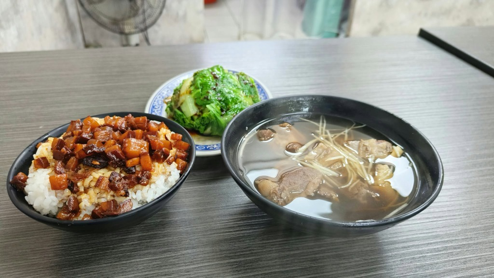

# 案件 001：滷肉飯照片辨識

## 案件資訊

- 案件編號：001
- 建立日期：2026-10-06
- 照片／線索：使用者提供的滷肉飯、湯品、青菜及店內桌面照片。
- 使用者指定地點：新北市（使用者最新提示；取代早先的台北公館／台南推測）。
- 使用者指定時間：未指定；依通用規則查目前仍營業的店家。
- 目前狀態：已找到高度吻合候選，待使用者確認

## 使用者提供的範圍與限制

- 可能地點：新北市。
- 指定日期或時間：無；希望找最新、目前有營業的店家。
- 其他限制：結論要提供店名及 Google Maps 地點。

## 照片觀察

### 餐點

- 可確認：白飯上有深色、油亮、切丁狀滷肉；另有一盤綠色青菜和一碗帶薑絲的清湯。使用者指出湯中肉塊似乎露出一小塊皮。
- 推測、待確認：湯料較可能是帶皮羊肉（新北候選店的羊肉湯照片相符），原先鴨肉判斷尚不能只憑原圖確定；青菜做法也尚未確認。

### 餐具與器皿

- 飯碗和湯碗為黑色；青菜放在藍白花紋盤上。

### 餐廳環境

- 桌面為灰色木紋桌；背景可見淺色牆面／磁磚及風扇等店內設備。

## 候選店家

目前高度吻合候選：中和一碗小肥羊（新北市中和區）。Google 地圖 2026 年 7 月近期照片可見黑飯碗、黑湯碗與灰木紋桌面，和原圖的核心特徵一致；品項含滷肉飯、羊肉湯及燙青菜。候選待使用者確認。排除名單與依據見同資料夾的 `案件-001.json`。

## 查證來源與日期

- Google Maps「中和一碗小肥羊」：2026-10-06 查得營業中、4.4 分／533 則評論；近期照片於 2026 年 7 月拍攝，器皿和桌面高度吻合。

## 結論

- 店名：中和一碗小肥羊（高度吻合，待使用者確認）
- Google Maps 地點：https://www.google.com/maps/place/中和一碗小肥羊/@24.9889331,121.5118622
- 把握度：高
- 主要依據：Google 地圖近期照片（2026 年 7 月）中飯碗、湯碗、桌面紋理與原圖高度相似；其羊肉湯帶皮肉塊和薑絲也能解釋原圖湯品。店家頁面顯示營業中。
- 尚未確認之處：青菜的藍白花盤尚未在同一張近期 Google 照片中核實；肉種判讀仍是依菜單品項及影像比對推測。
