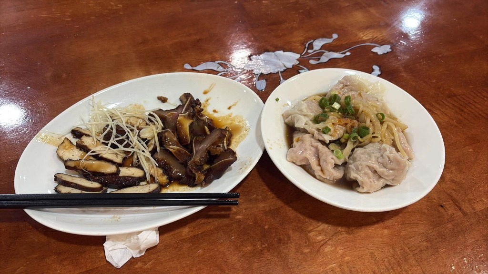

# 餐廳辨識案件

## 案件資訊

- 案件編號：004
- 建立日期：2026-10-15
- 照片／線索：大餛飩（抄手）與黑白切滷味照片
- 使用者指定地點：桃園市龍潭區（原推測）／桃園市中壢區（實際）
- 使用者指定時間：目前仍營業
- 目前狀態：已確認

## 使用者提供的範圍與限制

- 可能地點：桃園市龍潭區（原推測，後證實為桃園市中壢區）
- 指定日期或時間：目前仍營業
- 其他限制與提示：
  - 「應該在龍潭」（原提示）
  - 「關注一下原圖的大餛飩吧，那個比較少見」
  - 「感覺可以往紅油抄手那方面區搜」
  - 「後來問了中壢的，其實你找得第一家就是，是坐餓多端沒錯」（使用者最終確認）
  - 不得混用案件 001~003 的線索、候選與排除名單

## 照片觀察

### 餐點

- 可確認：
  - **大餛飩／紅油抄手**：
    - 一盤約 4~5 顆特大餛飩。
    - 形狀極為渾圓飽滿如肉丸，外皮極薄緊裹肉餡，表面呈現細密的大腦狀／蜂窩狀波浪皺褶（非一般溫州大餛飩之扁平拖長尾巴）。
    - 頂部覆蓋大量半透明條狀**榨菜絲**與翠綠**蔥花**。
    - 底部為清澈深褐色醬汁（醬油／香醋底），點綴微量橙紅辣油，非濃稠麻醬，亦非川味重油。
  - **黑白切滷味**：
    - 包含精細薄切的黑豆干、帶白色軟骨的深琥珀色切片豬耳朵。
    - 盤中央堆有極細的新鮮嫩薑絲，盤底帶有深色油膏／滷汁。
- 推測、待確認：
  - 店家招牌為「坐餓多端」的鮮蝦大抄手／鮮肉大餛飩。

### 餐具與器皿

- 餛飩盤：純白色帶淺深度之微凹圓盤。
- 滷味盤：純白色陶瓷橢圓盤。
- 餐具：黑色美耐皿／塑膠圓筷。

### 餐廳環境

- 桌面：深紅木紋實木桌面，表面平整亮漆，正中央有傳統螺鈿（珍珠貝殼鑲嵌）花卉枝葉圖案（非店內常見現代桌，可能為舊址家具、家中外帶用餐、或店內特殊角落桌位）。
- 椅／牆面：未入鏡。

## 使用者後續補充或更正

- 2026-10-15：使用者提示「應該在龍潭」。
- 2026-10-15：使用者提示「關注一下原圖的大餛飩吧，那個比較少見」。
- 2026-10-15：使用者提示「感覺可以往紅油抄手那方面區搜」。
- 2026-10-16：使用者確認：「後來問了中壢的，其實你找得第一家就是，是坐餓多端沒錯」。

## 候選與確認店家

| 店名 | Google Maps 地點 | 餐點符合處 | 環境／器皿符合處 | 不符合處／先前疑點 | 近期營業證據 | 判斷 |
| --- | --- | --- | --- | --- | --- | --- |
| **坐餓多端麵飯館**（原無餓不座） | [Google Maps](https://www.google.com/maps/place/%E5%9D%90%E9%A4%93%E5%A4%9A%E7%AB%AF%E9%BA%B5%E9%A3%AF%E9%A4%A8/@24.9466382,121.2257469,17z/data=!3m1!4b1!4m6!3m5!1s0x3468224b8b1c5d15:0xb81d04e3d588da1e!8m2!3d24.9466382!4d121.2257469!16s%2Fg%2F11b638hjrj) | 招牌手工特大餛飩/紅油抄手，渾圓飽滿、外皮皺褶完全一致；上方鋪大量榨菜絲與蔥花，附黑白切滷味與細薑絲 | 白色圓盤與白橢圓滷味盤吻合 | 地點位於中壢區林森路（原推測在龍潭）；螺鈿桌疑為外帶食用或特定座位 | 2026 年持續正常營業中 | **已確認（使用者證實）** |

## 排除名單

案件專屬排除名單存於同編號 JSON（`案件-004.json`），此處不重複列出。
主要排除店家（非本案店家）：
1. **龍潭市場餛飩**（中正路160巷8號）：餛飩小且一份十多顆、淋大量芝麻花生醬；攤位為不鏽鋼白鐵桌。
2. **九張桌溫州大餛飩**（中正路96號）：桌椅為淺木貼皮與黑鐵椅；餐具為花紋盤與紅塑膠碗。
3. **橋頭老麵店**（西龍路43號）：僅專賣榨菜肉絲麵與滷味，未販售餛飩或抄手。
4. **川之香 酸辣粉/重慶小麵/紅油抄手**（中興路198號）：重慶川味重油風格。
5. **糧園茶藝客家小館**（双連街90號）：為客家桌菜合菜館，無單點抄手或現切豆干耳朵小菜。
6. **三坑老街小吃（阿琴小吃、廟口麵攤等）**：主打客家粄條與湯圓，無特大紅油抄手。
7. **李記北方麵館**（中原路二段575號）：主打清燉牛肉麵、香酥淋餅與水餃，無抄手。
8. **好伴麵店 龍潭中正店**（中正路）：主打乾拌麵與水餃，無抄手或餛飩品項。
9. **開封餃子館**（民族路514巷17號）：民宅手工水餃與炒菜，無餛飩抄手。
10. **郭記麵館**（南龍路58號）：普通小吃店四人方桌。

## 查證來源與日期

- Google Maps 查核日期：2026-10-15、2026-10-16
- Google Lens 以圖搜尋比對日期：2026-10-15
- 使用者明確證實日期：2026-10-16

## 結論

- 店名：**坐餓多端麵飯館**（原平鎮「無餓不座麵食館」）
- Google Maps 地點：[坐餓多端麵飯館（桃園市中壢區林森路37號）](https://www.google.com/maps/place/%E5%9D%90%E9%A4%93%E5%A4%9A%E7%AB%AF%E9%BA%B5%E9%A3%AF%E9%A4%A8/@24.9466382,121.2257469,17z/data=!3m1!4b1!4m6!3m5!1s0x3468224b8b1c5d15:0xb81d04e3d588da1e!8m2!3d24.9466382!4d121.2257469!16s%2Fg%2F11b638hjrj)
- 把握度：高（使用者明確證實）
- 主要依據：
  - 核心指紋完全吻合：全台少見的「渾圓球形特大餛飩／紅油抄手」，外皮薄而緊緻呈細密腦狀皺褶，頂部覆蓋大量清脆榨菜絲與蔥花，底醬為微酸微辣的香醋辣油醬汁。
  - 黑白切滷味刀工完全一致：薄切黑豆干、帶白軟骨切片豬耳朵，正中央一大撮新鮮極細嫩薑絲。
  - 系統於 Google Lens 以圖搜尋第一時間抓出的精確候選即為「無餓不座 / 坐餓多端麵飯館」。
- 偏差成因分析：
  - 前期因「應該在龍潭」之地點提示，將搜尋重心集中於龍潭市區。
  - 照片中背景之「螺鈿花卉實木桌」與坐餓多端店內主流之現代淺木紋/白鐵美耐皿桌椅不同，推測可能為外帶至家中食用、或店內少數特殊擺設。
