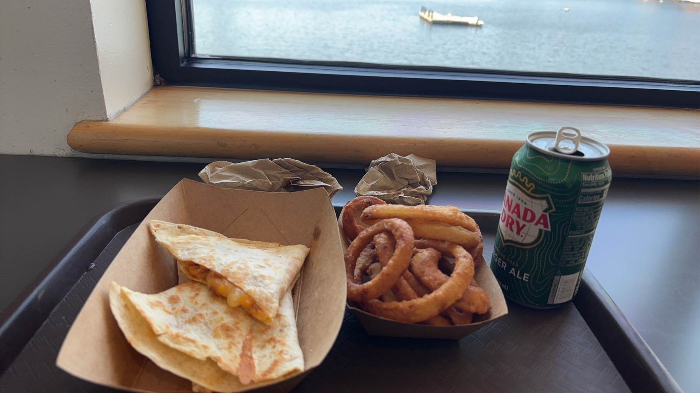

# 餐廳辨識案件

## 案件資訊

- 案件編號：005
- 建立日期：2026-10-16
- 照片／線索：`S__36651069.jpg`（墨西哥烤餅、炸洋蔥圈、Canada Dry 薑汁汽水與水景窗台）
- 使用者指定地點：德國（優先）或歐洲附近
- 使用者指定時間：目前仍營業（依鋁罐版權年份確認照片攝於 2024 年或之後）
- 目前狀態：調查中（已完成階段性物理與環境特徵拆解）

## 使用者提供的範圍與限制

- 可能地點：德國（優先）或歐洲附近（註：照片中汽水罐為 2024 年美國德州原裝生產、無德國 Pfand 押瓶標貼之版本，故同步保留「駐德／駐歐美軍設施或美式餐廳」與「美國本土水岸餐廳」雙軌查核）
- 指定日期或時間：目前仍營業（拍攝時間為 2024 年或之後）
- 其他限制：不得混用舊案件線索與排除名單

## 照片觀察

### 餐點

- 可確認：
  - **墨西哥起司烤餅（Quesadilla）**：兩片對折成扇形／半圓形的墨西哥麵餅（Flour tortilla），外皮有鐵板乾烙微焦斑點，內餡有融化的黃白雙色起司（Cheddar / Monterey Jack 風格，疑似夾有雞肉或蔬菜丁）。
  - **炸洋蔥圈（Onion rings）**：金黃色厚粉漿酥炸洋蔥圈（Beer-battered / thick-battered onion rings），約 7~8 圈。
  - **罐裝飲料（關鍵時間與產地證據）**：`Canada Dry Ginger Ale` 綠色鋁罐，正面左下標示美制為主之 `12 FL OZ (355 mL)`。右側為**美國 FDA 標準單語英文 `Nutrition Facts`**（含新版 `Includes 35g Added Sugars 70%` 標示），成分含 `CARBONATED WATER, HIGH FRUCTOSE CORN SYRUP`（高果糖玉米糖漿，美規配方）。罐身標示製造商與版權年份：`© 2024 DR PEPPER/SEVEN UP, INC., 6425 HALL OF FAME LANE, FRISCO, TX 75034`。條碼區為原印鋁罐條碼，未見德國 DPG 押瓶費（Pfand €0.25）貼紙或歐盟多語營養貼紙。
- 推測、待確認：
  - 屬於典型美式快餐／水岸休閒簡餐部（Snack Bar / Waterfront Grill / Galley Cafe）的餐點組合。

### 餐具與器皿

- 托盤：深棕色美式標準格紋防滑長方塑膠托盤（Cambro / Carlisle 風格）。
- 紙盒：兩個無印刷原色牛皮紙船形餐盒（Kraft paper food boats，一大一小）。
- 餐巾紙：兩團原色再生牛皮餐巾紙（Brown kraft dispenser napkins）。

### 餐廳環境

- 室內牆柱與窗台結構：
  - 左側為刷有米白色／淺奶油色乳膠漆的厚實室內牆柱（可見滾筒刷漆顆粒紋理與窗洞斜角導邊），確認為**陸上或大型碼頭木造／水泥建築室內**，而非小型船艙金屬艙壁。
  - 窗台為美式木工常見的**圓頭實木窗台板（Bullnose wooden window stool with returned rounded end）**，左端凸出牆角並做圓角收邊，表面塗有透明清漆。
  - 窗框為黑色鋁合金／金屬窗框；窗台正下方緊貼深灰棕色美耐皿桌面。
- 窗外水景與水面設施（約自 2 樓高度俯瞰）：
  - 窗外為開闊平靜水域（湖泊、內灣或寬河），右上角遠方可見對岸陸地岸際線。
  - 水面中央偏左有一座**孤立錨定的小型白色浮動碼頭／平台（Floating pontoon dock / platform）**，左側連有一道帶兩排垂直欄杆立柱（約 5~6 根）的斜坡引橋（Gangway ramp），右端帶有橘紅色標記與小型浮筒，水下有清晰倒影。
  - 浮動碼頭右後方遠處水面上，設有一顆**白色球形繫船浮標（White mooring buoy）**。

## 使用者後續補充或更正

- 2026-10-16：使用者提示「這題比較不一樣，應該是德國(優先)或是歐洲附近」。

## 候選方向與假設分析

| 方向／假設類型 | 地點範圍 | 吻合特徵 | 待釐清／矛盾點 | 目前狀態 |
| --- | --- | --- | --- | --- |
| **方向 A：駐德／駐歐美軍基地或美軍休閒設施（MWR / AAFES）** | 德國／歐洲（如 Chiemsee 湖畔美軍設施、Ramstein / Wiesbaden 周邊等） | 可合理化在德國境內直接販售無德國 Pfand 貼紙、2024 年美國德州原裝進口之 `Canada Dry` 鋁罐，且供應道地美式牛皮紙船盒 Quesadilla、洋蔥圈與 Cambro 托盤 | 需比對哪一處靠湖／靠河設施具備二樓景觀窗與水面孤立浮動碼頭 | 待查證 |
| **方向 B：德國／歐洲觀光水岸美式／墨西哥餐廳** | 德國或鄰近歐洲國家之湖泊／海灣／河岸 | 符合使用者對拍攝區域之記憶；歐洲部分美式餐廳會由平行輸入商進口美版 `Canada Dry` | 德國一般零售通路強制要求黏貼 DPG 押瓶標籤，內用餐廳雖偶有未貼標之整箱進口罐，但室內圓頭實木窗台（Bullnose window stool）與全套美式耗材高度偏向北美工法 | 待查證 |
| **方向 C：美國本土（或美加邊境）水岸／碼頭二樓簡餐館** | 美國本土（湖泊、海灣或港灣 Marina 二樓餐廳） | 100% 吻合 2024 美規 `Canada Dry` 鋁罐、美式圓頭實木窗台、Cambro 防滑托盤、Kraft 船形紙盒、Quesadilla + Onion Rings 組合，以及美式 Marina 常見之孤立浮動碼頭與白色球形 Mooring buoy | 與使用者初步記憶「德國或歐洲附近」不同（類似案件 004 記憶偏差之可能性） | 待查證 |

## 排除名單

案件專屬排除名單存於同編號 JSON（`案件-005.json`），此處不重複列出。

## 查證來源與日期

- Google Lens 全圖、局部餐點、窗台與水面設施多模態搜尋：2026-10-16
- 飲料罐營養標示、版權年份與條碼放大檢視：2026-10-16

## 結論

- 店名：尚無法確認（階段性整理）
- Google Maps 地點：待確認拍攝國家／區域後進一步鎖定
- 把握度：低
- 主要依據：已完成高解析度局部特徵拆解，確認照片攝於 **2024 年或之後**，且現場使用**美國本土原裝版 `Canada Dry` 鋁罐**與典型美式餐飲耗材、二樓水岸木質窗台，窗外水面有帶引橋欄杆之孤立浮動碼頭與白色繫船浮標。
- 尚未確認之處：確切水域與餐廳名稱（建議先與照片來源確認拍攝地是否可能位於美國，或為德國特定湖區／美軍相關區域）。
