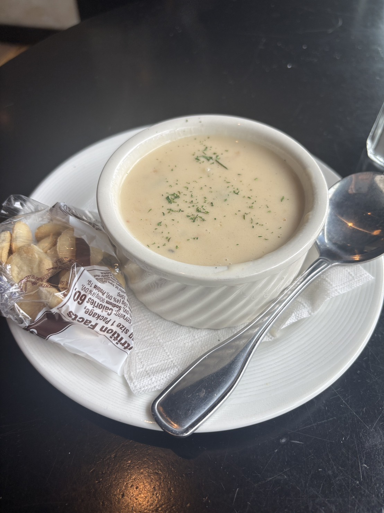

# 餐廳辨識案件

## 案件資訊

- 案件編號：006
- 建立日期：2026-10-16
- 照片／線索：`案件-006-巧達濃湯照片.jpg`（原圖檔名 `S__36700172.jpg`，白瓷斜紋螺旋湯盅裝巧達濃湯、附單包裝 Westminster 牡蠣餅乾、黑色圓桌）
- 使用者指定地點：美國（優先考慮美國東岸／波士頓周邊）
- 使用者指定時間：目前仍營業
- 目前狀態：調查中（已啟動 30 分鐘停損與進度回報）

## 使用者提供的範圍與限制

- 可能地點：應該也是美國（延續前案曾前往波士頓／美國東岸之足跡）
- 指定日期或時間：目前仍營業
- 其他限制：不得混用舊案件線索與排除名單

## 照片觀察

### 餐點

- 可確認：
  - **濃湯**：乳白色經典美式奶油濃湯，表面撒有乾燥洋香菜碎（Parsley flakes），質地濃稠均勻。
  - **配餐餅乾（核心指紋）**：單獨透明小塑膠袋裝的圓形澎澎**牡蠣餅乾（Oyster Crackers）**，確認為新英格蘭百年老牌 **Westminster Bakers Co.** 產品。背面印有美規 Nutrition Facts：
    - `Serving size 1 Package`
    - `Calories 60`
    - `Sodium 90mg (4% DV)`
    - `Total Carb. 10g (4% DV), Protein 1g`
    - 頂部印有 `...USA...` 與棕白標籤。
- 推測、待確認：
  - 高度確認為美式經典**新英格蘭蛤蜊巧達濃湯（New England Clam Chowder）**。

### 餐具與器皿（關鍵指紋）

- **湯盅（核心器皿特徵）**：白色陶瓷深口圓形湯盅（Soup crock / Souffle dish / Ramekin），容量約 8 oz。
  - 碗口帶有向外微翻的加厚圓唇（Rolled rim）。
  - **碗身外壁帶有極具辨識度的斜向螺旋浮雕條紋（Swirl / Spiral fluted ribs）**。
  - 此設計吻合餐飲商用瓷器大廠型號（如 **Tuxton DuraTux BEX-0804** 或 **CAC China SOFS-8-EW**）。
- **底盤與餐巾紙**：白色陶瓷平底圓盤（盤緣外圈有數道細微的同心圓浮雕線圈）；湯盅與盤子之間墊有一張對折呈三角形的白色壓花餐巾紙。
- **湯匙**：不鏽鋼西式大湯匙，握柄周圍有一圈凹陷鑲邊滾邊線條（Line rim flatware）。

### 餐廳環境

- **桌面**：黑色平光圓桌（桌面邊緣帶有圓弧倒角修飾），材質為黑漆實木或黑色美耐皿；右上角反光處可見重底透明玻璃水杯或調味罐底部。
- **遠景**：左上角地面可見淺灰／米白地磚或淺色木質地板，以及黑色踢腳板邊緣。

## 使用者後續補充或更正

- 2026-10-16：使用者提供原圖檔名 `S__36700172.jpg`，並備註「應該也是美國」。

## 候選店家

| 店名 | Google Maps 地點 | 餐點符合處 | 環境／器皿符合處 | 不符合處 | 近期營業證據 | 判斷 |
| --- | --- | --- | --- | --- | --- | --- |
| （目前比對中） | - | - | - | - | - | 待使用者縮小城市範圍 |

## 排除名單

經第一輪高密度比對波士頓、劍橋、塞勒姆、紐約等 25 家以上著名海鮮餐廳，下列店家之器皿或呈現方式皆已明確排除：

1. **Legal Sea Foods**（波士頓多間分店）：使用自家專屬藍色 Logo 餅乾袋與特製寬口碗／外帶紙杯，非 Westminster 棕色公版包裝。
2. **Union Oyster House**（波士頓自由之路）：使用深綠／深褐雙圈白瓷碗，固定配歷史地圖桌墊。
3. **The Boston Sail Loft**（波士頓水岸）：以滿溢杯緣的招牌陶瓷馬克杯（Mug）聞名。
4. **Ned Devine's Irish Pub**（Faneuil Hall）：圓柱直筒光滑白碗，底盤固定墊黑色紙巾。
5. **Atlantic Fish Company**（波士頓後灣）：使用獅頭雙耳白瓷盅（Lion head bowl）或麵包碗，餐巾紙印有 Atlantic Fish 字樣。
6. **Summer Shack**（波士頓／劍橋）：碗緣印有紅色標語圈 'Summer Shack food is love'。
7. **The Barking Crab**（波士頓 Seaport）：主要使用黃底紅字免洗紙杯。
8. **Cheers Boston**（波士頓 Beacon Hill）：濃湯僅以馬克杯（Mug）或麵包碗供應。
9. **Warren Tavern**（查爾斯鎮）：平滑無斜紋之圓碗。
10. **The Black Rose**（波士頓金融區）：藍邊瓷碗或深色平滑碗。
11. **Bell in Hand Tavern**（波士頓最老酒館）：雙耳獅頭盅或八角直筒盅。
12. **Green Dragon Tavern**（波士頓）：平滑外壁圓碗。
13. **Chart House**（波士頓 Long Wharf）：寬口平滑白瓷淺碗。
14. **Joe's Waterfront / Joe's on Newbury**：傾斜深碗或直筒圓碗。
15. **Granary Tavern**（波士頓）：以黑色鑄鐵小吊鍋（Cauldron pot）盛裝。
16. **The Hourly Oyster House**（劍橋哈佛廣場）：小餅乾盛裝於獨立小白盅內，非袋裝；碗壁平滑。
17. **Salty Dog Oyster Bar & Grill**（Faneuil Hall）：印有自家藍色魚形標誌之陶瓷馬克杯。
18. **Beantown Pub**（波士頓 Tremont St）：寬唇淺平碗或深褐色雙耳陶盅。
19. **21st Amendment**（波士頓 Beacon Hill）：大尺寸寬緣淺湯盤。
20. **Neptune Oyster**（波士頓小義大利）：印有 Neptune 標誌之寬淺湯盤或大平盤。
21. **Row 34**（波士頓 Seaport）：碗壁平滑且固定插上一大片自製三角形薄脆餅。
22. **The Daily Catch**（波士頓小義大利）：寬平盤盛裝，中間固定飾有一整顆炸蛤蜊泡芙。
23. **Yankee Lobster**（波士頓 Seaport）：外帶免洗紙杯盛裝。
24. **Grand Central Oyster Bar**（紐約中央車站）：紅白格紋桌布或白色大理石吧台配寬沿淺盤。
25. **Fraunces Tavern**（紐約金融區）：平滑厚唇碗配切片黑麥麵包。
26. **Cull & Pistol**（紐約 Chelsea Market）：底盤印有 CULL & PISTOL 黑色專屬字樣。
27. **Water View Grill**（Portsmouth, NH）：Yelp 標記已歇業，且碗身為光滑圓碗。

## 查證來源與日期

- 查證日期：2026-10-16
- 工具：本機 Chrome 9222 CDP 自動化比對、Google Lens 多模態影像檢索、Yelp / Toast 實拍影像分析。

## 結論

- 店名：尚無法確認（已鎖定關鍵器皿與附餐指紋）
- Google Maps 地點：調查中
- 把握度：中（物證非常清晰，但屬於未印店名之通用型商用器皿）
- 主要依據：已精確辨識出 **Westminster Bakers Co. 單包裝牡蠣餅乾** 與 **Tuxton/CAC 款式斜螺旋紋深湯盅（Swirl Souffle/Crock）** 及黑色圓桌。
- 尚未確認之處：確切城市（是否為波士頓市區、劍橋、紐約、或波士頓往北沿海小鎮如 Salem / Gloucester / Rockport / Cape Cod）以及餐廳型態（海鮮餐廳、酒吧、牛排館或飯店附設餐廳）。
