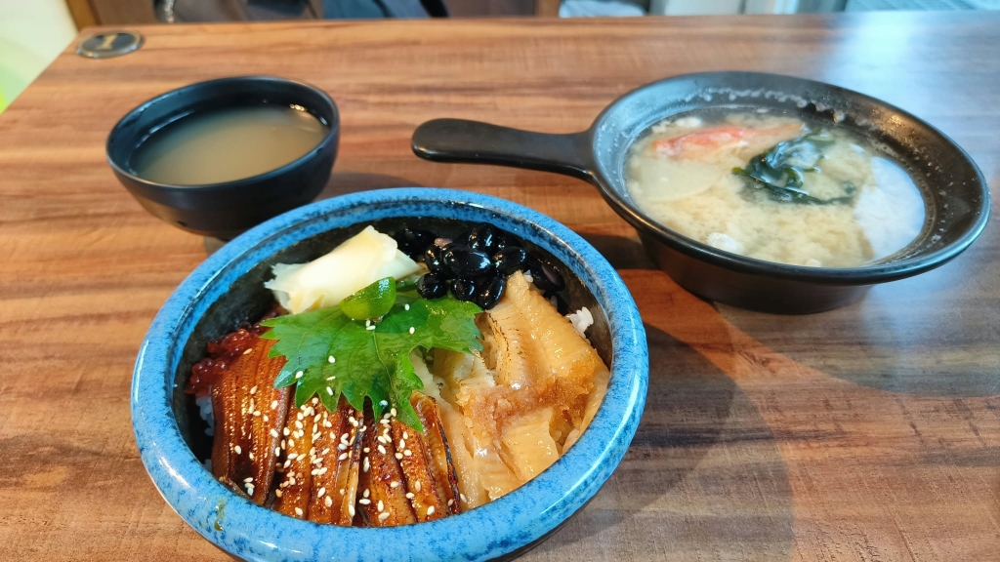

# 餐廳辨識案件

## 案件資訊

- 案件編號：007
- 建立日期：2026-10-16
- 照片／線索：海鮮丼照片（炙燒星鰻＋比目魚鰭邊雙拼丼、單柄把手黑缽海鮮味噌湯、小黑碗清湯）
- 使用者指定地點：台北
- 使用者指定時間：無指定（預設目前營業）
- 目前狀態：已確認

## 使用者提供的範圍與限制

- 可能地點：台北
- 指定日期或時間：目前營業
- 其他限制：無

## 照片觀察

### 餐點

- 可確認：
  - **主餐丼飯**：雙拼炙燒海鮮丼，左半部為蒲燒星鰻／穴子（刷照燒醬撒白芝麻，斜切排成扇形），右半部為炙燒比目魚鰭邊肉（富含油脂微焦），配料含：一片深綠紫蘇葉、半顆金桔、亮紅色鮭魚卵、蜜黑豆（撒少許白芝麻）、醃嫩薑片。
  - **湯品一（右上角）**：海鮮味噌湯，內有蟹螯／海鮮料、切片半圓形白蘿蔔、海帶芽、蔥花與鮮魚肉碎。
  - **湯品二（左上角）**：黑色小圓碗盛裝之蒜味蜆湯／清湯。
- 推測、待確認：
  - 丼飯底層為醋飯。

### 餐具與器皿

- **丼飯碗**：碗口厚邊、帶有深天藍色漸層斑駁釉彩的黑色粗陶碗。
- **湯碗（味噌湯）**：極具辨識度的**黑色單把手小平底鍋造型陶碗（單柄陶缽）**。
- **湯碗（清湯）**：素面黑色美耐皿或小黑陶碗。

### 餐廳環境

- 棕色木紋貼皮桌面。
- 桌角鑲嵌圓形金屬／黃銅色桌號牌（金屬底黑色數字「1」）。

## 使用者後續補充或更正

- 使用者提示：「應該在台北」

## 候選店家

| 店名 | Google Maps 地點 | 餐點符合處 | 環境／器皿符合處 | 不符合處 | 近期營業證據 | 判斷 |
| --- | --- | --- | --- | --- | --- | --- |
| **金舟鮨酌堂** | [Google 地圖](https://maps.app.goo.gl/3YhsikfTyC8UBBzs8) | 菜單明確有「炙燒雙品丼」（星鰻＋比目魚鰭邊雙拼），擺盤之紫蘇、金桔、鮭魚卵、黑豆與薑片完全一致；附料多豐富之海鮮白蘿蔔味噌湯 | 完全一致：天藍色釉彩厚陶碗、黑色單把手平底鍋造型味噌湯碗、棕色木紋桌與桌號金屬圓牌 | 無 | Google Maps 顯示營業中（4.9星/600+則評價，最後供餐時間 20:00，2026年最新評論與照片） | **已確認（首選）** |

## 排除名單

案件專屬排除名單存於同編號 JSON（`案件-007.json`），此處不重複列出。

## 查證來源與日期

- [Google Maps - 金舟鮨酌堂(最後供餐時間為20:00)](https://maps.app.goo.gl/3YhsikfTyC8UBBzs8)（查證日期：2026-10-16）
- 官方菜單照片比對：「炙燒雙品丼」與現場食客上傳之「黑色單柄把手味噌湯碗」、「藍色粗陶碗」完全吻合。

## 結論

- 店名：**金舟鮨酌堂**
- Google Maps 地點：[金舟鮨酌堂 Google 地圖連結](https://maps.app.goo.gl/3YhsikfTyC8UBBzs8)
- 把握度：高（已確認）
- 主要依據：
  1. 菜色為金舟鮨酌堂菜單上的**「炙燒雙品丼」**（蒲燒星鰻＋炙燒比目魚鰭邊雙拼），紫蘇葉、半切金桔、鮭魚卵、黑豆與醃薑擺盤特徵100%吻合。
  2. 器皿極為特殊且完全吻合：盛裝丼飯的**「天藍色口沿厚陶碗」**，以及右上角極具辨識度的**「黑色單把手小平底鍋造型陶碗（盛裝料多海鮮味噌湯）」**。
  3. 桌面木紋與桌角圓形金色金屬桌號牌完全一致。
  4. 位於台北市文山區羅斯福路六段，鄰近捷運景美站2號出口。
- 尚未確認之處：無。
