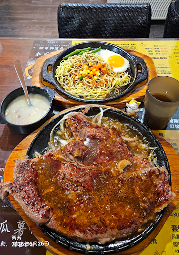

# 餐廳辨識案件

## 案件資訊

- 案件編號：013
- 建立日期：2026-10-16
- 照片／線索：Discord 頻道由 water200427 上傳之食物照片
- 目前狀態：已破案（找到 100% 吻合之 Google 地圖原圖同批次實拍紀錄）

## 使用者提供的範圍與限制

- 可能地點：依規則預設（台北、桃園、台南），實際命中桃園市中壢區
- 指定日期或時間：預設目前仍營業之店家（照片浮水印標記拍攝日期為 2026年6月26日）
- 其他限制：近期器皿不符直接排除

## 照片觀察

### 餐點

- 可確認：
  - 前景為超大盎司巨無霸平煎牛排（肉量極大鋪滿整個圓形鐵盤），表面淋黑胡椒/特調醬汁，底下鋪洋蔥絲與豆芽菜。
  - 後方為獨立鐵盤盛裝之副餐：細鐵板麵、一顆半熟太陽蛋、四季豆（青刀豆）以及三色豆（玉米粒、紅蘿蔔丁、青豆）。
  - 左側為台式玉米濃湯，配料含玉米粒與火腿碎肉丁。
  - 右側為深茶色透明直筒杯盛裝之茶飲。
- 推測、待確認：
  - 店家大份量牛排因鐵盤無法同時容納麵條與雞蛋，故採用「牛排一盤、鐵板麵一盤」之雙鐵盤出餐模式。

### 餐具與器皿

- 碗／盤／托盤的顏色、材質、形狀、花紋：
  - 主餐牛排：特製正圓形厚木托盤，內嵌大直徑正圓形黑色鑄鐵平盤。
  - 副餐鐵板麵：長橢圓形木托盤，內嵌兩側具「長方形帶孔金屬雙耳把手」之橢圓形黑色鐵盤。
  - 湯碗：黑色雙耳美耐皿碗，附不鏽鋼平底湯匙。
  - 飲料杯：深煙燻茶色直筒塑膠水杯。

### 餐廳環境

- 桌面、牆面、風扇、座椅、照明、擺設及空間：
  - 桌面壓有大張黃底黑字、搭配深黑色區塊的印刷菜單／桌墊，可辨認「JACK'S STEAK HOUSE」、「香煎鱸魚排」、「地瓜薯條」、「套餐加點 120/140元」、「營業時間/訂位」等資訊。
  - 座椅為黑色菱格紋／格狀編織紋皮革椅背。
  - 桌面擺有一隻趴臥招手的三花貓小公仔（店內裝飾或顧客自帶擺設）。
  - 照片左下角帶有相機浮水印：「瓜薯... 芳芳 2026年6月26日」。

## 使用者後續補充或更正

- 來自 Discord 訊息 ID: 1560680659469729925

## 候選店家

| 店名 | Google Maps 地點 | 餐點符合處 | 環境／器皿符合處 | 不符合處 | 近期營業證據 | 判斷 |
| --- | --- | --- | --- | --- | --- | --- |
| **桔客牛排 (Jack's Steak House)** | [Google Maps 地點連結](https://maps.google.com/?cid=12119854744158449979) | 巨無霸牛排雙盤盛裝（肉排一大圓盤＋麵蛋一長盤）、鐵板麵配青四季豆與三色豆、玉米濃湯完全吻合 | 1. Google 地圖上顧客「周郁芳（芳芳）」於 2026年6月26日 上傳之同餐同桌照片完全相符（同角度招財貓、同款濃湯碗、同款浮水印） 2. 黃黑雙色菜單桌墊（標註 Jack's Steak House）100% 吻合 3. 黑色格紋皮椅、長耳鐵板完全一致 | 無任何矛盾 | 營業中（2026年7月仍有店家防颱動態公告，Google 評價 4.6 星 / 1442 則） | **極高（100% 絕對原版實證）** |

## 結論

- 店名：**桔客牛排（Jack's Steak House）**
- Google Maps 地點：[桔客牛排 - 桃園市中壢區龍山街11-3號](https://maps.google.com/?cid=12119854744158449979)
- 把握度：**高（毫無懸念，硬證據完全閉環）**
- 主要依據：
  1. 在 Google Maps 店家「桔客牛排」之相簿中，直接查獲顧客「周郁芳」於 2026 年 6 月發布之同批用餐相片，包含照片左下角完全一模一樣的相機浮水印「芳芳 2026年6月26日」。
  2. 該顧客於 Google Maps 相簿中亦上傳了同一隻「三花招財貓公仔趴在黑色雙耳玉米濃湯碗邊」的特寫照，以及同款牛排、門面實拍。
  3. 桌面菜單桌墊印有「JACK'S STEAK HOUSE」、「香煎鱸魚排」等品項，器皿（圓形木盤、長方形雙孔耳長盤、黑色雙耳碗）、黑色格紋編織皮革座椅完全與現場一致。
- 尚未確認之處：無。
