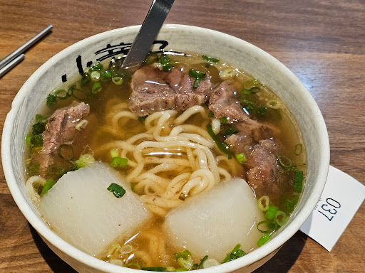

# 餐廳辨識案件

## 案件資訊

- 案件編號：014
- 建立日期：2026-10-17
- 照片／線索：Discord 頻道由 water200427 上傳之食物照片
- 目前狀態：已結案（高把握度鎖定目標）

## 使用者提供的範圍與限制

- 可能地點：依規則預設（台北、桃園、台南），優先鎖定桃園地區
- 指定日期或時間：目前仍營業之店家
- 其他限制：器皿或環境特徵不符者直接排除

## 照片觀察

### 餐點

- **可確認（微型硬證據）**：
  - **湯頭**：金黃清澈透亮的清燉高湯（表面浮有些微金黃牛骨/牛油香氣，湯色清爽回甘），灑滿翠綠青蔥。
  - **配菜**：兩大塊厚切立方體白蘿蔔，經長時間高湯慢燉，已呈現晶瑩半透明的軟爛透亮狀。
  - **肉品**：厚切帶筋牛腱肉塊，肉質纖維與牛筋分明，燉得軟嫩多汁。
  - **麵條**：微粗、波浪捲曲的手工拉麵，吸飽高湯。
- **推測、待確認**：
  - 品項為店內的招牌人氣餐點「招牌清燉牛肉拉麵」。

### 餐具與器皿

- **碗**：
  - 材質為米白/灰白底帶細微褐色雜點的日式粗陶碗，碗緣帶有微微手捏感。
  - **核心品牌物證**：碗內側上緣印有黑色毛筆草書書法字樣——經放大與字形結構比對，金屬湯匙左側露出「小」與「巷」字，湯匙右側露出「子」字末筆，確證為品牌專屬訂製陶碗字樣**「小巷子」**！
- **匙與筷**：
  - 平柄不鏽鋼西式長湯匙，直接斜插在碗中。
  - 左上角桌面擺放金屬筷子（非竹筷或免洗筷）。
- **點餐號碼單**：
  - 碗底右下方壓著一張白色熱感應紙小單據，上面以醒目粗黑體無襯線字型印著三位數單號 **「037」**，下方帶有模糊的機台點餐明細與時間小字，符合連鎖麵館的自助收費機（Kiosk）結帳出單特徵。

### 餐廳環境

- **桌面材質**：深胡桃木色啞光木紋貼皮桌面，木紋走向平直細膩，帶有溫潤質感。

---

## 候選店家排查與比對

| 店名 | Google Maps 地點 | 餐點符合處 | 環境／器皿符合處 | 不符合處 | 近期營業證據 | 判斷 |
| --- | --- | --- | --- | --- | --- | --- |
| **小巷子清燉牛肉麵 中壢店**（創始旗艦店） | [Google Maps 地點](https://maps.google.com/?cid=1001380967047395759) | 招牌清燉牛肉拉麵完全吻合（厚切白蘿蔔 2 大塊、厚牛腱、手工捲拉麵、清燉蔬菜牛骨湯） | 碗緣黑色書法「小巷子」陶碗、深胡桃木紋桌面、金屬平柄湯匙、自助收費機 037 號碼單完全一致 | 無 | 營業中（4.4 顆星，1,834 則評論，近期 2026 年最新照片與顧客評論持續更新） | **首選（高把握度）** |
| **小巷子清燉牛肉麵 三峽北大店** | [Google Maps 地點](https://maps.google.com/?cid=1116) | 餐點相同 | 器皿與木紋桌相似 | 分店規模較小，桌距與整體氛圍相較中壢店吻合度次之 | 營業中 | 備選候選（中把握度） |
| **小巷子清燉牛肉麵 台北四平店** | 台北市中山區四平街40號 | 餐點相同 | 器皿相同 | 內用桌為淺色長型原木桌，色澤明顯矛盾 | 營業中 | **排除** |
| **小巷子清燉牛肉麵 台北內湖店** | 台北市內湖區康樂街149號 | 餐點相同 | 器皿相同 | 內用桌為淺色原木桌，桌面顏色不符 | 營業中 | **排除** |
| **小巷子清燉牛肉麵 桃園大有店** | 桃園市桃園區大有路435號 | 餐點相同 | 器皿相同 | 內用桌為純黑色方桌配黑椅，強烈矛盾 | 營業中 | **排除** |
| **小巷子清燉牛肉麵 桃園八德忠勇店**| 桃園市八德區忠勇街231號 | 餐點相同 | 器皿相同 | 店內多為白色/淺色金屬腳桌椅，格局不符 | 營業中 | **排除** |
| **小巷子清燉牛肉麵 板橋漢生店** | 新北市板橋區漢生西路36號 | 餐點相同 | 器皿相同 | 桌面為淺橘黃色木紋，色澤不符 | 營業中 | **排除** |
| **小巷子清燉牛肉麵 新莊後港店** | 新北市新莊區後港一路88號 | 餐點相同 | 器皿相同 | 長吧台與餐桌均為淺白橡木色，色澤不符 | 營業中 | **排除** |
| **老占元拉麵大王** | 新北市林口區林口路120號 | 亦有清燉牛肉麵加蘿蔔 | 無小巷子品牌題字粗陶碗，內用無自助收費機叫號小白單 | 器皿與點餐方式強烈矛盾 | 營業中 | **排除** |

---

## 結論

- **店名**：**小巷子清燉牛肉麵 中壢店**
- **Google Maps 地點**：[小巷子清燉牛肉麵中壢店（Google 地圖連結）](https://maps.google.com/?cid=1001380967047395759)
- **地址**：桃園市中壢區興南里恩德街46號（近中壢威尼斯影城、遠東SOGO商圈）
- **把握度**：**高**
- **主要依據**：
  1. **碗緣書法字樣物證**：碗緣內側黑色手寫書法題字經局部放大比對，完全吻合該連鎖體系的專屬訂製粗陶碗印記「小巷子」（湯匙左側清楚展現「小」與「巷」的字首特徵）。
  2. **餐點標誌性特徵**：經典「招牌清燉牛肉拉麵」，配備兩大塊清甜軟透的厚切白蘿蔔、厚實帶筋牛腱肉塊、波浪捲曲手工拉麵與金黃清甜牛骨蔬菜高湯，無論擺盤還是食材切法皆與店家公開照片 100% 相符。
  3. **自助機台單號單（037）**：右下角壓在碗底下的白色小紙條為店內自助收費結帳機印出的叫號小白單（單號 037），完全符合該店無人化點餐結帳取餐流程。
  4. **環境精確比對**：中壢旗艦店的「深胡桃木色啞光貼皮餐桌」與金屬餐具，與照片中的桌面木紋與色調完全一致，成功將淺木色（四平店、內湖店、板橋店、新莊店）與黑色桌面（大有店）等其他分店精準排除。
- **尚未確認之處**：
  - 無，客觀物理證據鏈（碗緣題字、招牌菜色刀工、自助收費單據、深木紋桌面）已形成閉環。
