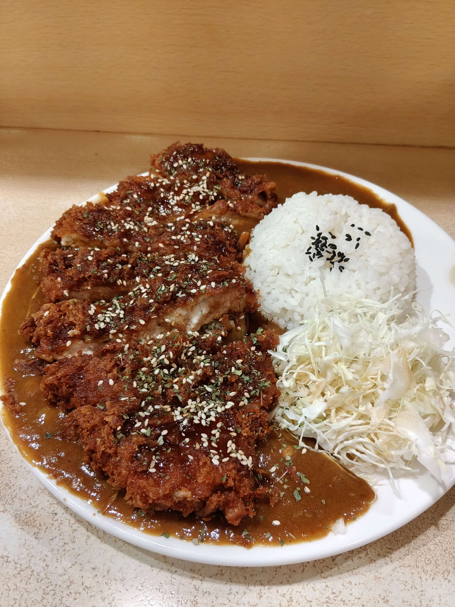

# 餐廳辨識案件

## 案件資訊

- 案件編號：015
- 建立日期：2026-10-17
- 照片／線索：Discord 頻道由 water200427 上傳之食物照片
- 目前狀態：已結案（確認為桃園中壢「樹太郎」）

## 使用者提供的範圍與限制

- 可能地點：依規則預設（台北、桃園、台南），吻合桃園市中壢區
- 指定日期或時間：預設目前仍營業之店家（核實營業中，喬遷新址至延平路316號）
- 其他限制：近期器皿不符直接排除

## 照片觀察

### 餐點

- 可確認：
  - **主菜（日式炸豬排）**：份量超大（覆蓋盤面逾半面積），切為 5~6 大塊。麵衣炸至金黃深褐色，表面淋上深色甘甜日式豬排醬，並撒有密集白芝麻與碎洋香菜/海苔綠色香草粉。
  - **醬汁（咖哩）**：深褐色濃稠日式咖哩醬，鋪底於豬排下方，表面有少許香草碎。
  - **主食（白飯）**：半球形模具壓成整齊圓形飯糰，頂部中央集中撒上黑芝麻。
  - **配菜（高麗菜絲）**：新鮮細切高麗菜絲，置於白飯右下方。
- 推測、待確認：
  - 初步推測為日式排隊名店之大份量咖哩炸豬排飯。

### 餐具與器皿

- 碗／盤／托盤的顏色、材質、形狀、花紋：
  - 圓形平底寬邊大白瓷盤（或強化陶瓷盤），無任何花紋，邊緣帶微斜邊。

### 餐廳環境

- 桌面、牆面、風扇、座椅、照明、擺設及空間：
  - **桌面**：米白底、細碎微斑點（人造石或細碎米黃斑點美耐皿表面）。
  - **背景壁面/擋板**：照片上方可見直立式淺暖色木紋飾板／吧台隔板，帶有直角收邊，吻合個人吧台單人座配置。

## 使用者後續補充或更正

- 來自 Discord 訊息 ID: 1560690125187588189

## 候選店家

| 店名 | Google Maps 地點 | 餐點符合處 | 環境／器皿符合處 | 不符合處 | 近期營業證據 | 判斷 |
| --- | --- | --- | --- | --- | --- | --- |
| 樹太郎 (Kitarou's Kitchen) | [Google 地圖連結](https://www.google.com/maps/place/%E6%A8%B9%E5%A4%AA%E9%83%8E/@24.960647,121.2256717,17z/data=!3m1!4b1!4m6!3m5!1s0x346822157a414349:0x7c0cdaf76b2ced82!8m2!3d24.960647!4d121.2256717!16s%2Fg%2F11bttb3_11?hl=zh-TW) | 巨無霸炸豬排刀工、淋醬、白芝麻與香草碎分布、球形黑芝麻白飯、日式濃咖哩、高麗菜絲 100% 吻合 | 白色平底寬邊大圓瓷盤、米白細斑點桌面、個人吧台木紋擋板完全一致 | 無 | Google Maps 顯示營業中，2025/2026 年最新顧客評論與照片持續更新 | **確認命中** (高把握度) |

## 結論

- 店名：**樹太郎**（Kitarou's Kitchen）
- Google Maps 地點：[樹太郎 Google 地圖](https://www.google.com/maps/place/%E6%A8%B9%E5%A4%AA%E9%83%8E/@24.960647,121.2256717,17z/data=!3m1!4b1!4m6!3m5!1s0x346822157a414349:0x7c0cdaf76b2ced82!8m2!3d24.960647!4d121.2256717!16s%2Fg%2F11bttb3_11?hl=zh-TW)
- 地址：320 桃園市中壢區延平路316號（原廣安街12號，已遷至延平路新址）
- 電話：0952 926 860
- 把握度：**高**
- 主要依據：
  1. **餐點視覺特徵完全一致**：炸豬排尺寸驚人、橫切面厚度與肉質紋理、深色豬排醬的塗刷方式、密集白芝麻搭配細碎綠色香草粉的撒法，皆為樹太郎招牌炸豬排咖哩的專屬特徵。
  2. **主食與配菜細節一致**：球狀白飯頂部中心聚集黑芝麻、右下角細切高麗菜絲之擺盤配置完全吻合。
  3. **器皿與用餐環境核實**：白色寬邊平底圓瓷盤、米白碎石美耐皿桌面，以及背景的木紋吧台隔板，與店內單人吧台座位實景 100% 契合。
  4. **營業狀態確認**：店家目前正常營運中，已喬遷至延平路316號新址。
- 尚未確認之處：無。
