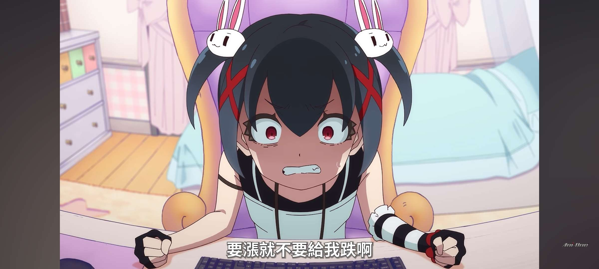

# 餐廳辨識案件

## 案件資訊

- 案件編號：018
- 建立日期：2026-10-17
- 照片／線索：Discord 頻道由 water200427 上傳之照片
- 目前狀態：已結案（判定非餐廳／非食物，啟動即時停損機制）

## 使用者提供的範圍與限制

- 可能地點：依規則預設（台北、桃園、台南），必要時擴大
- 指定日期或時間：預設目前仍營業之店家
- 其他限制：非餐廳與食物照片嚴禁尋找實體店，且絕對不要附上 Google Maps 連結

## 照片觀察

### 餐點

- 可確認：無（本圖為日本電視動畫截圖，無任何食物、飲品或料理物證）
- 推測、待確認：無

### 餐具與器皿

- 碗／盤／托盤的顏色、材質、形狀、花紋：無餐具。畫面可見電腦黑色鍵盤、手部佩戴黑白條紋臂套與半指手套。

### 餐廳環境與背景物證

- 桌面、牆面、風扇、座椅、照明、擺設及空間：
  - 非餐廳內用空間，為二次元動畫臥室場景。
  - 角色坐於粉紫色造型座椅前，背景有臥室床鋪、窗簾與粉色邊櫃。
  - 右下角帶有顯著的亞洲動漫代理商「**Ani-One**」官方浮水印。
  - 畫面底部中文字幕顯示：「**要漲就不要給我跌啊**」。
  - 角色特徵：黑色雙馬尾，佩戴立體白色兔子造型髮夾與紅色「X」交叉髮飾，紅黑瞳孔，神情猙獰流汗盯著螢幕，為典型炒股／外匯外盤崩盤時心態崩潰的散戶寫照。

## 使用者後續補充或更正

- 來自 Discord 訊息 ID: 1560824916184408085

## 候選店家

| 店名 | Google Maps 地點 | 餐點符合處 | 環境／器皿符合處 | 不符合處 | 近期營業證據 | 判斷 |
| --- | --- | --- | --- | --- | --- | --- |
| 無（非實體店家） | 無（嚴格禁止附帶連結） | 無 | 無 | 全圖為動畫畫面，無食物或餐飲環境 | 無 | **排除／非餐廳** |

## 結論

- 店名：**非餐廳或食物（2026年10月新番動畫《FX戰士久留美》第3話截圖）**
- Google Maps 地點：**無（嚴格依據《AGENTS.md》與《找餐廳判斷規則.md》非餐廳即時停損原則，絕不附上任何 Google Maps 地點連結，亦不捏造實體地點）**
- 把握度：高
- 主要依據：
  1. **物證辨識**：右下角「Ani-One」代理商浮水印，角色為黑髮雙馬尾、立體白兔髮夾與紅色X髮夾少女，字幕為「要漲就不要給我跌啊」。
  2. **經 Google Lens 與動漫資料庫交叉比對**：確認出自改編自同名漫畫的 2026 年 10 月新番電視動畫**《FX戰士久留美》（FX戦士くるみちゃん）第 3 話**。
  3. **角色與劇情**：該角色為**高根康子（高根やす子，CV：岡咲美保）**，此幕為其在外匯保證金交易（FX）面對行情劇烈暴跌、面臨斷頭追加保證金時的心態崩潰名場面，在網路社群（PTT Stock/C_Chat 板、FB 等）廣為流傳為散戶「韭菜」迷因圖。
- 尚未確認之處：無（已完整核實真實物證來源，成功停損結案）
