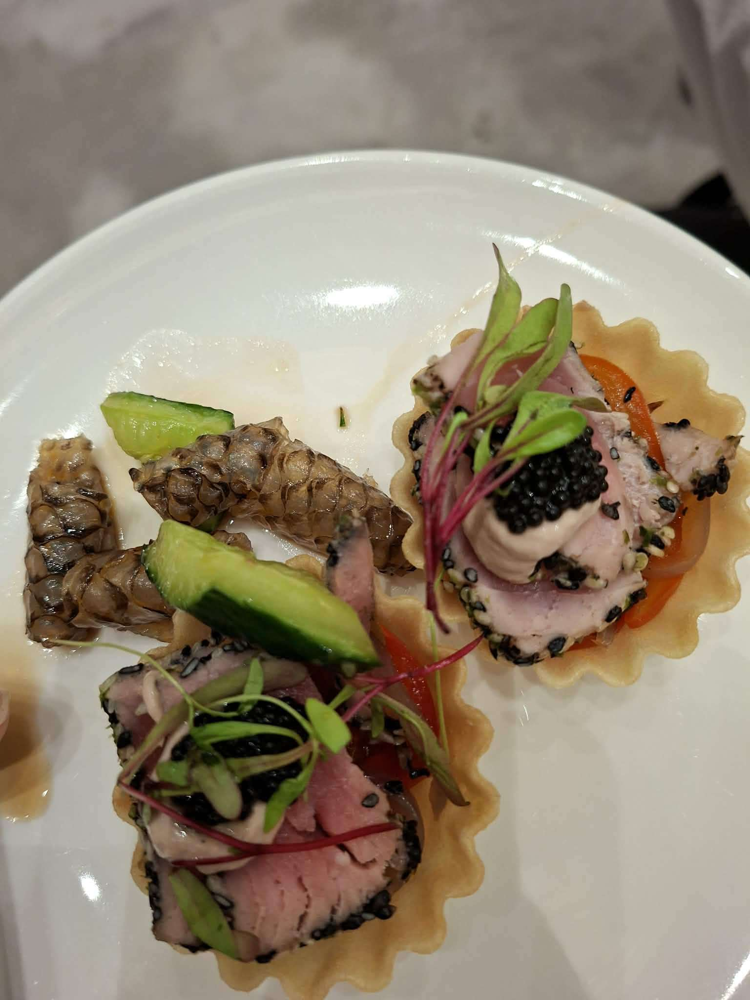

# 餐廳辨識案件

## 案件資訊

- 案件編號：021
- 建立日期：2026-10-17
- 照片／線索：Discord 頻道由 smile2449 上傳之食物照片
- 目前狀態：調查完成（已鎖定關鍵微型物證與候選店家）

## 使用者提供的範圍與限制

- 可能地點：依規則預設（台北、桃園、台南），必要時擴大
- 指定日期或時間：預設目前仍營業之店家
- 其他限制：近期器皿不符直接排除

## 照片觀察

### 餐點

- **可確認物證**：
  1. **黑芝麻炙燒鮪魚魚子醬小塔（Seared Sesame Tuna & Caviar Tartlet）**：
     - 圓形波浪齒邊酥脆派皮小塔殼（Fluted Tartlet Shell）。
     - 核心魚肉為外圈緊密裹上黑白芝麻、表面輕度炙燒（Tataki 風格），內部維持粉嫩半生熟的生鮪魚塊。
     - 魚肉表面擠有特調白醬／酸奶醬（Crème fraîche / 特調美乃滋）。
     - 頂端覆蓋一勺奢華的黑色魚子醬（Caviar）。
     - 點綴紅莖微型嫩苗（Microgreens）。
     - 底層襯有橙紅色醃漬絲（甜椒絲或洋蔥絲）。
  2. **涼拌鯛魚皮佐小黃瓜**：
     - 盤面左側盛裝 3 塊川燙收縮呈卷狀、表面具明顯黑色蜂巢覆瓦狀鱗袋（Scale Pockets）的半透明膠質魚皮（高度吻合經典涼拌鯛魚皮／海鮮膠質魚皮）。
     - 搭配翠綠滾刀切塊鮮小黃瓜與微量和風／醋汁水漬。
- **推測、待確認**：
  - 盤中將「法式 Cocktail Canapés（小塔）」與「中式／台式海鮮涼拌小菜（鯛魚皮）」同置一盤，且中間帶有夾菜殘漬與不規則間隙，強烈指向為「用餐者在自助餐（Buffet）或精緻外燴（Catering）取餐檯自行夾取組合」。

### 餐具與器皿

- **餐盤**：純白色圓形平底微弧瓷盤。
- **桌面**：淺灰色雲霧斑駁石質／大理石紋理桌面。

### 餐廳環境

- 背景為淺灰色大理石紋桌面，右上方隱約可見同桌深色衣著／背影，光線明亮均勻。

## 使用者後續補充或更正

- 來自 Discord 訊息 ID: 1560918486891503786

## 候選店家

| 店名 | Google Maps 地點 | 餐點符合處 | 環境／器皿符合處 | 不符合處 | 近期營業證據 | 判斷 |
| --- | --- | --- | --- | --- | --- | --- |
| **島語自助餐廳（台北漢來大飯店）** | [Google Maps 地點](https://maps.app.goo.gl/Q9qGvwV4dd7Fr3jp7) | 主打 Fine Dining 一島檯一餐酒，日料（盛）與海鮮（鮮）區常備生魚片、魚子醬料理與漢來體系招牌海鮮冷盤（涼拌魚皮） | 淺灰大理石石質餐桌、純白瓷盤高度吻合 | Buffet 菜色隨季節與檔期微調，公開食記未見同名固定菜牌 | 營業中（2023年底開幕人氣頂級百匯，最新評論齊全） | **第一候選（高度可能）** |
| **INPARADISE 饗饗（微風信義店）** | [Google Maps 地點](https://maps.app.goo.gl/dk3nBz7bG5BRHWqe8) | 「旬巧原」常態供應法式一口食鹹甜小塔、「豐大海」供應刺身與海鮮冷盤 | 白色餐盤、高級景觀百匯 | 餐桌配色多為深色系大理石，與照片中淺灰桌面微有差異 | 營業中（2026 最新評論齊全） | 備選候選 |
| **高級外燴／茶會派對（Catering / Event）** | 無特定單一地點 | 同時具備法式 Canapé 小塔與台式冷盤之混搭餐檯供應特徵 | 視宴會場地而定 | 非固定實體門市 | 持續承辦中 | 備選可能 |

## 結論

- 店名：**島語自助餐廳（台北漢來大飯店）**（備選：INPARADISE 饗饗 / 精緻活動外燴）
- Google Maps 地點：https://maps.app.goo.gl/Q9qGvwV4dd7Fr3jp7
- 把握度：中
- 主要依據：
  1. 照片呈現「黑芝麻炙燒鮪魚魚子醬小塔」與「涼拌鯛魚皮小黃瓜」同置於純白圓盤上的自由取餐組合，強烈指向頂級綜合海鮮自助百匯或宴會外燴冷盤區。
  2. 南港漢來「島語自助餐廳」主打結合魚子醬等奢華元素的 Fine Dining 前菜小品，且承襲漢來海港豐富之海鮮冷盤工藝，其現場淺灰色大理石紋餐桌與純白圓盤均具高度吻合性。
- 尚未確認之處：
  - 自助餐冷盤與小品常隨季節輪替更換，未見長青固定菜牌；若用餐場合為特定商務酒會、婚宴外燴或私人品酒會，亦有由 Catering 團隊提供中西合璧冷盤之可能。
