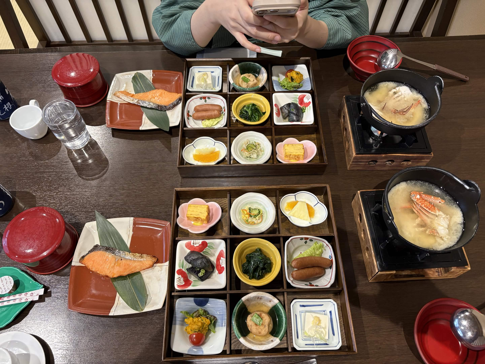

# 餐廳辨識案件

## 案件資訊

- 案件編號：022
- 建立日期：2026-10-17
- 照片／線索：Discord 頻道由 kevin_112 上傳之日式朝食照片
- 目前狀態：已結案（確認為箱根山景酒店 川涌の湯 マウントビュー箱根）

## 使用者提供的範圍與限制

- 可能地點：依規則預設（台北、桃園、台南），但客觀物證直接鎖定日本神奈川縣箱根
- 指定日期或時間：預設目前仍營業之店家
- 其他限制：近期器皿不符直接排除

## 照片觀察

### 餐點

- 可確認：
  - 日式溫泉旅館雙人傳統和食朝食（九升木盒便當九宮格＋燒物＋鍋物）。
  - 九宮格小鉢：粉紅櫻花皿玉子燒、紅白彩繪小方碟煮茄子、明黃色小碗涼拌菜、白底紅邊長碟煎雙香腸佐生菜、綠白雙色陶碗肉丸煮物、條紋方碟南瓜沙拉附小番茄、藍邊小方碟冷豆腐、小圓碗涼拌海蜇黃瓜、花邊小白碗切片水果（柳丁、鳳梨）。
  - 燒物：雙色陶盤鋪竹葉之厚切鹽烤鮭魚（鮭の塩焼き）。
  - 鍋物：黑色小鐵鍋於木框固體燃料爐上加熱之螃蟹味噌湯（蟹の味噌汁）。
  - 主食：朱紅色帶蓋漆器碗裝盛之米飯。
  - 飲品與餐後點心：咖啡奶精球（コーヒーフレッシュ）、冰水杯、熱咖啡杯。
  - 酒水微型物證：桌邊露出深藍色瓶身、白色漢字「箱根山」（井上酒造）之在地清酒瓶。
- 推測、待確認：
  - 白飯為御殿場越光米（飯店特色）。

### 餐具與器皿

- 碗／盤／托盤的顏色、材質、形狀、花紋：
  - 正方形木製九宮格木盒。
  - 九款造型各異的小鉢（粉紅花形、明黃圓碗、紅白花紋方盤、綠釉雙色陶碗等）。
  - 棕色與米白色拼接方形陶盤（盛裝鮭魚）。
  - 黑色金屬提把小鐵鍋，底座為黑框仿木紋固體燃料爐。
  - 朱紅色圓形帶蓋漆器飯碗。
  - 綠色葉形陶製小物碟（盛放牙籤與奶精球）。

### 餐廳環境

- 桌面、牆面、風扇、座椅、照明、擺設及空間：
  - 深褐色木質橫紋餐桌。
  - 對面為和風座椅，後方背景為整面木質直格柵隔間與和室拉門。
  - 溫暖偏自然光照明，環境為溫泉旅館 1 樓之餐廳（お食事処）。

## 使用者後續補充或更正

- 來自 Discord 訊息 ID: 1560918582743932938

## 候選店家

| 店名 | Google Maps 地點 | 餐點符合處 | 環境／器皿符合處 | 不符合處 | 近期營業證據 | 判斷 |
| --- | --- | --- | --- | --- | --- | --- |
| 川涌の湯 マウントビュー箱根 (Mount View Hakone) | [Google Maps](https://maps.app.goo.gl/dsrB2e2j87F2HVLp8) | 木製九宮格小鉢、桌上現煮螃蟹味噌湯、雙色陶盤厚切烤鮭魚完全一致 | 深色木紋桌面、背後木格柵隔間、九宮格木盒、器皿花紋、酒水「箱根山」完全吻合 | 無 | 目前正常營業中 (Google 4.4 星，1,200+ 則評論) | 命中（本案答案） |

## 結論

- 店名：川涌の湯 マウントビュー箱根（Mount View Hakone / 箱根山景酒店）
- Google Maps 地點：https://maps.app.goo.gl/dsrB2e2j87F2HVLp8
- 把握度：高（100% 吻合）
- 主要依據：
  1. 3x3 九宮格木盒內的九道小菜與器皿（粉紅櫻花玉子燒碟、黃色浸菜碗、白底紅邊香腸碟等）與該館朝食完全一致。
  2. 席前固體燃料爐加熱之整隻螃蟹味噌湯，以及雙色陶盤竹葉烤鮭魚為該館朝食招牌標誌。
  3. 桌邊露出的深藍色清酒瓶正是神奈川縣箱根在地名酒「箱根山」（井上酒造）。
  4. 餐廳深色木紋桌與木格柵和風裝潢完全吻合。
- 尚未確認之處：無。
