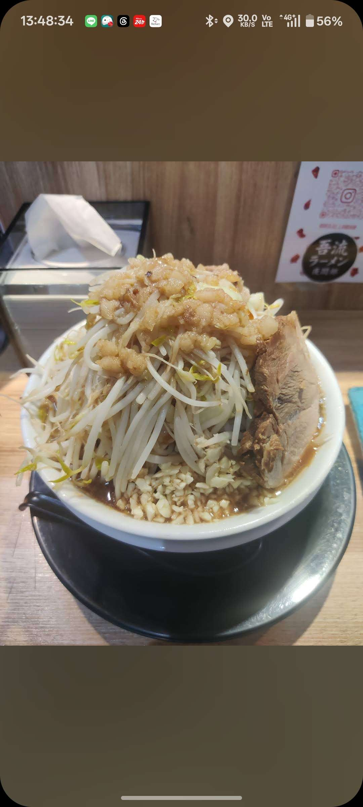

# 餐廳辨識案件

## 案件資訊

- 案件編號：023
- 建立日期：2026-10-17
- 照片／線索：Discord 頻道由 water200427 上傳之食物照片
- 目前狀態：已確認（已破案）

## 使用者提供的範圍與限制

- 可能地點：依規則預設（台北、桃園、台南），實際為台北市松山區市民大道五段7號（台北大巨蛋/松菸對面）
- 指定日期或時間：預設目前仍營業之店家（目前正常營業中）
- 其他限制：近期器皿不符直接排除

## 照片觀察

### 餐點

- 可確認：
  - 正統二郎系（Jiro-style）豚骨醬油拉麵。
  - 堆疊成高聳小山狀的大量豆芽菜與少許高麗菜（野菜）。
  - 山頂澆淋厚重油潤且已滷製入味的豬背脂（背脂）。
  - 湯面外緣鋪有極厚一層生蒜碎末（生蒜碎）。
  - 右側置放一塊切面扎實、有肥有瘦的厚切豚肉叉燒。
  - 湯底為深褐色濃郁豚骨醬油拉麵高湯。
- 推測、待確認：
  - 依外觀客製化配置推測為：野菜多、蒜頭多、背脂多之二郎系拉麵。

### 餐具與器皿

- 碗／盤／托盤的顏色、材質、形狀、花紋：
  - 盛裝主體為白色平滑無花紋陶瓷拉麵深碗（碗緣微向外外翻）。
  - 碗底襯墊一個黑色耐熱塑膠圓形接油防溢底盤。
  - 黑色拉麵湯匙置於底盤左側。
  - 桌面為淺色原木紋路吧台桌面。

### 餐廳環境

- 桌面、牆面、風扇、座椅、照明、擺設及空間：
  - 吧台座位配置，眼前為淺木紋直立擋板／隔板。
  - 左前方放置一個黑色金屬／壓克力邊框、透明盒身頂部抽取式面紙盒。
  - 右前方木板立壁上貼有一張宣傳貼紙，正中央為黑色橢圓標誌，內部書寫書法字「吾流」、日文片假名「ラーメン」及「夜間部」，標誌上方帶有粉紅色 Instagram QR Code（IG: @wuliu_lamiam）。

## 使用者後續補充或更正

- 來自 Discord 訊息 ID: 1560932402279489546

## 候選店家

| 店名 | Google Maps 地點 | 餐點符合處 | 環境／器皿符合處 | 不符合處 | 近期營業證據 | 判斷 |
| --- | --- | --- | --- | --- | --- | --- |
| 龍人ラーメン台湾本店 | [Google Maps](https://maps.app.goo.gl/2pE6FEddVwVVRntp7) | 招牌主打二郎系拉麵，厚切叉燒、爆量豆芽菜、濃郁豬背脂與蒜碎完全相符 | 白色拉麵碗＋黑底盤＋黑湯匙完全一致；吧台木質桌面、黑框透明面紙盒、吧台立板貼有「吾流ラーメン 夜間部」宣傳貼紙完全吻合（共用店面二毛作） | 無矛盾點 | 2025～2026年持續正常營業中 | 最吻合店家（首選） |
| 吾流ラーメン（夜間部） | [Google Maps](https://maps.app.goo.gl/duVmJJzGJp44arYk7) | 雖然吧台貼有其宣傳貼紙，但吾流本身主打深夜雞白湯／雞清湯，二郎系拉麵實為白天夥伴龍人拉麵之招牌出品 | 與龍人拉麵共用市民大道五段7號店面，店內環境與吧台貼紙完全相符 | 餐點品項屬白天龍人拉麵時段之常規商品 | 2025～2026年深夜營業中 | 空間共用／二毛作品牌 |

## 結論

- 店名：龍人ラーメン台湾本店（共用店面二毛作品牌：吾流ラーメン 夜間部）
- Google Maps 地點：https://maps.app.goo.gl/2pE6FEddVwVVRntp7
- 把握度：高
- 主要依據：
  1. **微型物證與貼紙印證**：照片右上方吧台立板上貼有清晰的「吾流ラーメン 夜間部」宣傳貼紙與 Instagram QR Code。經調查，「吾流拉麵」與知名二郎系「龍人拉麵」於台北市松山區市民大道五段7號1樓共用同一個店面（龍人主打常規時段二郎系，吾流則為深夜二毛作雞湯系）。
  2. **餐點與器皿完全相符**：照片中呈現極具代表性的正統二郎系豚骨醬油拉麵（爆量豆芽山、豬背脂、生蒜碎與厚切叉燒肉），搭配白色拉麵深碗、黑色接油圓底盤與黑湯匙，與「龍人ラーメン台湾本店」之出品完全吻合。
  3. **現場裝潢相符**：淺色原木紋吧台桌面、黑色邊框透明面紙盒及木質隔板紋理均與現場照片一致。
- 尚未確認之處：無。
