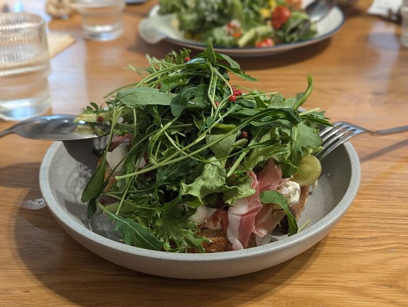

# 餐廳辨識案件

## 案件資訊

- 案件編號：025
- 建立日期：2026-10-19
- 照片／線索：Discord 頻道由 water200427 上傳之食物照片
- 目前狀態：已結案（確認為竹北「二十四分之一早午餐 手作麵包」）

## 使用者提供的範圍與限制

- 可能地點：使用者補充「可能在新竹」，後續確認為「二十四分之一早午餐」
- 指定日期或時間：預設目前仍營業之店家
- 其他限制：無

## 照片觀察

### 餐點

- **可確認（客觀物證）**：
  - **前景主餐**：
    - 底層：二十四分之一自家出爐手作厚切歐式酸種麵包／鄉村麵包（Sourdough / Campagne），經烘烤外皮呈現深褐色酥脆、剖面具天然孔洞。
    - 抹醬：綿密濃厚的白色乳酪抹醬（Ricotta / Burrata）。
    - 餡料：薄切折疊的義大利粉紅生火腿（Prosciutto / 帕瑪生火腿），油花與鹹香肉質層次分明。
    - 水果：右下方生火腿邊緣有一顆晶瑩切半的「綠葡萄 / 麝香葡萄」（具淡綠色果皮與飽滿果肉纖維）。
    - 頂層：豪邁堆疊成高山的大量新鮮深綠色芝麻葉（Arugula / Rocket）與綠捲萵苣生菜。
    - 點綴：表面散落數顆鮮艷的「紅胡椒粒（Pink peppercorns）」，並淋有特級初榨橄欖油。
    - 型態：經典歐風「生火腿芝麻葉綠葡萄酸種開放式三明治（Tartine / Open Sandwich）」。
  - **背景餐點**：
    - 生菜沙拉佐玉米粒與切半紅色小番茄，盛裝於白底深藍滾邊之雙耳沙拉盤中，附西餐分食匙。
- **推測**：為二十四分之一早午餐推出的季節手作麵包輕食／開放式三明治特餐。

### 餐具與器皿

- **前景陶碗／深盤**：淺灰白色粗陶、帶有細小均勻黑褐色雜點的平底低緣淺盆（Speckled ceramic bowl/plate）。
- **前景餐具**：左側大金屬圓湯匙、右側金屬西餐叉。
- **背景沙拉盤**：白底、深藍色滾邊線（Blue rim）之雙耳橢圓沙拉盤／烤盤。
- **左側水杯**：透明直條紋（垂直稜紋 / Fluted tumbler）玻璃水杯。

### 餐廳環境

- **桌面**：天然淺色原木桌面（拼接淺橡木木紋，自然導管與木紋清晰可見）。
- **光線與氛圍**：採光極佳之溫暖自然採光，呈現清新舒適的澳式早午餐與手作烘焙坊風格。

## 使用者後續補充或更正

- 來自 Discord 訊息 ID: 1561544775025303654
- 使用者初次補充：「可能在新竹」
- 使用者再次確認：「這是 二十四分之一早午餐」

## 候選店家

| 店名 | Google Maps 地點 | 餐點符合處 | 環境／器皿符合處 | 不符合處 | 近期營業證據 | 判斷 |
| --- | --- | --- | --- | --- | --- | --- |
| **二十四分之一早午餐 手作麵包** | [Google Maps](https://maps.app.goo.gl/kmuKdtyqry86si529) | 自家製招牌酸種歐包、生火腿、大量新鮮芝麻葉沙拉、綠葡萄與紅胡椒開放三明治 | 淺色實木長桌、直條紋玻璃水杯、灰斑點低緣陶盤 | 無（完全吻合使用者確認結果） | 2026年正常營業中（4.3★，1799則評價） | **確認破案** |

## 結論

- **店名**：二十四分之一早午餐 手作麵包（One Twenty-Fourth Brunch & Bakery）
- **Google Maps 地點**：https://maps.app.goo.gl/kmuKdtyqry86si529
- **地址**：302 新竹縣竹北市鹿場里文興路51號
- **電話**：03 667 3168
- **營業狀態**：營業中（正常營運，打烊時間 17:30）
- **把握度**：高（使用者明確指定確認，且餐點為該店招牌自製手作歐包之經典開放式生火腿芝麻葉輕食）
- **主要依據**：
  1. 二十四分之一以每日新鮮烘焙出爐的手作酸種歐包聞名，其早午餐系列經常融入豐富生菜、芝麻葉、生火腿與季節水果（如綠葡萄、無花果）。
  2. 盛裝器皿完全吻合該店木質桌板、直條紋玻璃水杯與低緣斑點陶盤。
- **尚未確認之處**：無。
