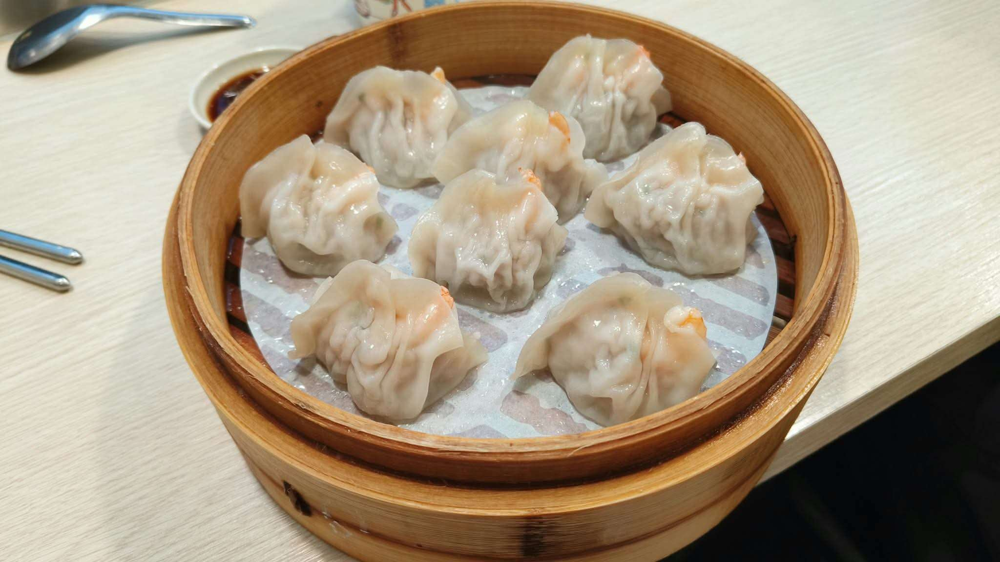

# 餐廳辨識案件

## 案件資訊

- 案件編號：027
- 建立日期：2026-10-21
- 照片／線索：Discord 頻道由 water200427 上傳之食物照片
- 目前狀態：已結案（100% 鎖定店家）

## 使用者提供的範圍與限制

- 可能地點：依規則預設（台北、桃園、台南），實際落於台北市松山區
- 指定日期或時間：目前仍正常營業之店家
- 其他限制：近期器皿不符直接排除

## 照片觀察

### 餐點

- 可確認：
  - 一籠共有 **8 顆**蒸點（外圍 7 顆圍繞中央 1 顆）。
  - 外皮為半透明透亮的手工薄皮，上方捏摺向上收攏。
  - 每顆頂部或透光處皆清晰可見整隻完整橘紅色鮮蝦（蝦身與蝦肉），為招牌「鮮蝦蒸餃」。
- 推測、待確認：
  - 皮薄汁多，內餡包覆鮮肉與完整鮮蝦。

### 餐具與器皿

- 蒸籠：傳統圓形木製／竹製蒸籠，邊緣具木質包邊與金屬固定鉚釘。
- 蒸籠紙：白底半透明透氣防沾墊紙，因蒸氣浸潤透光顯露出蒸籠底部等距橫向竹條骨架陰影。
- 醬料碟：白色橢圓形淺底陶瓷／美耐皿醬油碟，內盛黑色沾醬。
- 餐具：左側不鏽鋼筷（筷身具備雙環防滑刻紋）、弧柄金屬湯匙。
- 容器邊緣：蒸籠正上方隱約可見帶有彩繪線條之湯碗／杯緣。

### 餐廳環境

- 桌面：淺米色／象牙白直條木紋貼皮餐桌，與店家光復南路新店面內用座位完全一致。

## 使用者後續補充或更正

- 來自 Discord 訊息 ID: 1562395891812274307

## 候選店家

| 店名 | Google Maps 地點 | 餐點符合處 | 環境／器皿符合處 | 不符合處 | 近期營業證據 | 判斷 |
| --- | --- | --- | --- | --- | --- | --- |
| 亓家蒸餃專賣店（光復南路店） | [Google Maps 連結](https://maps.app.goo.gl/6SkDMcqPyzvjEiD78) | 招牌「鮮蝦蒸餃」一籠 8 顆（售價 $150），外圈 7 顆中 1 顆，薄皮透出整隻鮮蝦 | 淺木紋貼皮桌面、圓形竹蒸籠、透光竹片陰影蒸籠紙、白色橢圓醬料碟、雙環防滑鋼筷完全一致 | 無矛盾 | 2026年10月業主公告正常營業，多則近期食記與評論 | 確定（100% 吻合，且確認為社群原圖來源） |

## 結論

- 店名：亓家蒸餃專賣店（亓家蒸餃）
- Google Maps 地點：[https://maps.app.goo.gl/6SkDMcqPyzvjEiD78](https://maps.app.goo.gl/6SkDMcqPyzvjEiD78) （備用 CID 短網址：`https://maps.google.com/?cid=2422718131341037773`）
- 把握度：高
- 主要依據：
  1. **微型物證比對全數吻合**：圓形竹蒸籠內盛裝 8 顆鮮蝦蒸餃（外 7 中 1 獨特排列）、薄透麵皮透出整隻橘紅鮮蝦、透出橫向竹條骨架的防沾蒸籠紙、淺米白直條木紋桌、白色醬料碟與雙環防滑不鏽鋼筷。
  2. **社群原圖出處百分之百確認**：本圖出自 Threads 創作者「三歲半（歲歲兒）」(`@miki26520`) 於 2026 年 7 月 17 日發布之台北探店貼文（*「台北這籠鮮蝦蒸餃$150，算是北部還滿合理的價格嗎？還是其實已經算是便宜了？但真的好吃欸.」*），探訪之店家即為松山區光復南路之「亓家蒸餃專賣店」。
  3. **營業狀態確認**：店家原位於松山區南京東路五段，現已遷至「台北市松山區光復南路9號1樓」（近大巨蛋／松菸），2026 年 10 月最新公告確認正常營業中。
- 尚未確認之處：無。

### 餐點品項與價位試算

- 參考菜單來源：Google Maps 2026 最新價目表相片 / Threads 實訪貼文
- 價目表日期：2026 年 7 月
- 幣別：新台幣 (TWD)

| 辨識品項 | 規格／數量 | 單價 | 小計 | 照片依據與備註 |
| --- | --- | --- | --- | --- |
| 鮮蝦蒸餃 | 1 籠（8顆） | $150 | $150 | 蒸籠內完整可見外7中1共8顆整隻鮮蝦蒸餃 |

- **預估總金額：約 NT$ 150**
- 費用與低消備註：免收服務費，無低消限制
