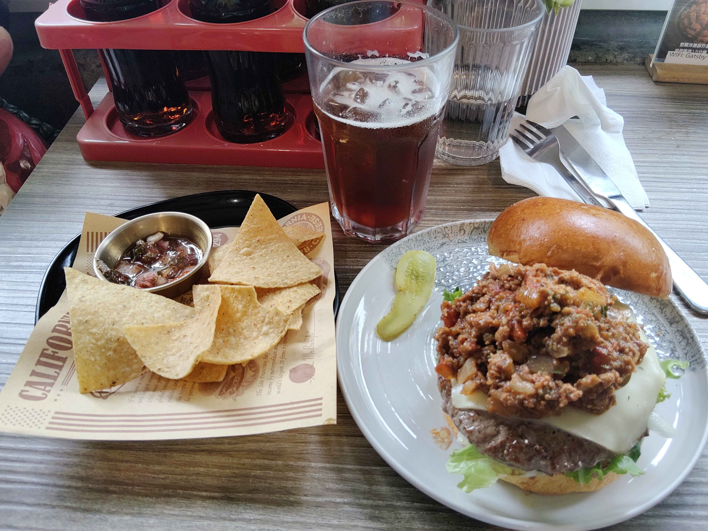

# 餐廳辨識案件

## 案件資訊

- 案件編號：028
- 建立日期：2026-10-22
- 照片／線索：Discord 頻道由 water200427 上傳之美式漢堡餐點照片（訊息 ID: 1562677496418410598）
- 目前狀態：已結案（已鎖定店家並完成價目表試算）

## 使用者提供的範圍與限制

- 可能地點：依規則預設（雙北地區）
- 指定日期或時間：預設目前仍營業之店家
- 其他限制：嚴格依據物證與餐具器皿核對

## 照片觀察

### 餐點

- **主餐（美式漢堡）**：
  - 上蓋為金黃油亮的布里歐漢堡包（Brioche bun），掀開立於陶盤一旁。
  - 下半部包含底部麵包、新鮮綠捲生菜、厚切牛肉漢堡排、大片融化的白色起司（瑞士/蒙特利起司）。
  - 肉排上方覆蓋大量且厚實的墨西哥辣肉醬（Chili con carne，可見番茄丁、洋蔥丁與燉煮牛絞肉碎）。
  - 盤緣附有一片波浪切酸黃瓜（Pickle slice）。
- **副餐（玉米脆片）**：
  - 黑色圓形平盤盛裝金黃三角形玉米脆片（Tortilla Chips / Nachos）。
  - 附一小金屬圓碟，內裝新鮮番茄莎莎醬（Salsa，可見番茄碎、紫洋蔥碎與香草香料碎）。
- **飲品**：
  - 多邊形/八角切面厚底透明玻璃高杯，盛裝加冰塊之深色冰飲（紅茶或冷泡茶）。
  - 旁有直條紋壓花透明圓筒玻璃水杯，內裝開水。

### 餐具與器皿

- **漢堡盤**：淺灰色/米白色陶瓷淺盤，盤緣飾有細緻淡墨綠色/灰藍色蔓藤植物花紋。
- **玉米片盤與襯紙**：黑色平盤，底部墊有一張吸油襯紙，上面印有報紙風格圖文「CALIFORNIA CHEESE... The San Francisco Bay...」英文字樣與圓形加州徽章。
- **醬料碟**：圓形不鏽鋼小醬碟。
- **杯具**：
  - 八角切面多邊形玻璃杯（裝飲料）。
  - 直條紋壓花透明圓筒玻璃杯（裝水）。
- **刀叉**：不鏽鋼西餐刀叉（刀刃刻有 STAINL...），置於白色餐巾紙上。
- **調味料籃**：紅色塑膠提籃，放置於左上角，內有多瓶調味料瓶。
- **桌上立牌**：木質長方形溝槽底座，透明壓克力立牌，內容為「整顆洋蔥酥炸... 現做等待15分鐘」，下方貼有標籤紙標註「WiFi: Gatsby...」。

### 餐廳環境

- **桌面**：灰褐色仿舊橫條木紋美耐板桌面。
- **靠窗結構**：桌邊緊鄰窗台矮台面，台面為老台式建築常見的深墨綠色/蛇紋石細密磨石子（洗石子）材質，上方為採光良好的白色窗框與牆面。

## 候選店家

| 店名 | Google Maps 地點 | 餐點符合處 | 環境／器皿符合處 | 不符合處 | 近期營業證據 | 判斷 |
| --- | --- | --- | --- | --- | --- | --- |
| **蓋子美式餐廳（板橋店）** | [Google Maps 連結](https://maps.app.goo.gl/P7HVEqra8Ua9KyH96) | 墨西哥辣肉醬漢堡、布里歐漢堡包、玉米片佐莎莎醬、整顆洋蔥酥炸花完全一致 | 灰木紋桌面、靠窗磨石子台面、立牌「WiFi: Gatsby」、藤蔓花紋陶瓷盤、直條紋水杯、紅色調味籃完全吻合 | 無明顯矛盾 | 2026年營業中（inline訂位、Google Maps 近期評論更新） | **最符合（首選）** |
| **蓋子普拉斯小餐館-新生店** | [Google Maps 連結](https://maps.app.goo.gl/hdoj1jAKmNVsgnJD8) | 同體系二店，招牌洋蔥花、漢堡、薄餅、玉米片等菜單品項通用 | 餐盤器皿及玉米片防油襯紙通用 | 新生店店名為 Gatsby Plus，店內裝潢主打純白現代風，靠窗區非磨石子老窗台結構 | 2026年營業中 | 備選（同體系二店） |

## 結論

- **店名**：蓋子美式餐廳（板橋店）/ Gatsby Diner
- **Google Maps 地點**：[https://maps.app.goo.gl/P7HVEqra8Ua9KyH96](https://maps.app.goo.gl/P7HVEqra8Ua9KyH96)
  - （地址：220新北市板橋區建國街127號）
- **把握度**：高
- **主要依據**：
  1. 桌上立牌清楚印有「整顆洋蔥酥炸... 現做等待15分鐘」及「WiFi: Gatsby...」，直接點明店名「Gatsby」與該店全台知名的招牌名菜「熔岩起司薯泥洋蔥花」。
  2. 桌面灰木紋材質、老宅靠窗之墨綠色磨石子台面，精確吻合板橋建國街老街區門市之臨窗格局。
  3. 漢堡盛裝之蔓藤花紋陶盤、黑平盤墊「CALIFORNIA CHEESE」舊金山報紙風吸油紙盛裝玉米片、金屬莎莎醬碟、直條紋玻璃水杯等細節器皿完全一致。
- **餐點品項與價位試算（參考 2025～2026 最新價目表）**：
  - **主餐**：墨西哥辣肉醬牛肉漢堡（搭配布里歐麵包、純牛漢堡排、起司、生菜、酸黃瓜） —— **NT$ 245**
  - **套餐升級**：升級經典套餐（含玉米脆片佐自製莎莎醬＋冰紅茶） —— **NT$ 100**
  - **服務費**：免收服務費（0%）
  - **預估總金額**：**NT$ 345 元**
- **尚未確認之處**：若為單點玉米脆片小點（非套餐加價），總金額可能落在約 NT$ 375 元左右。
