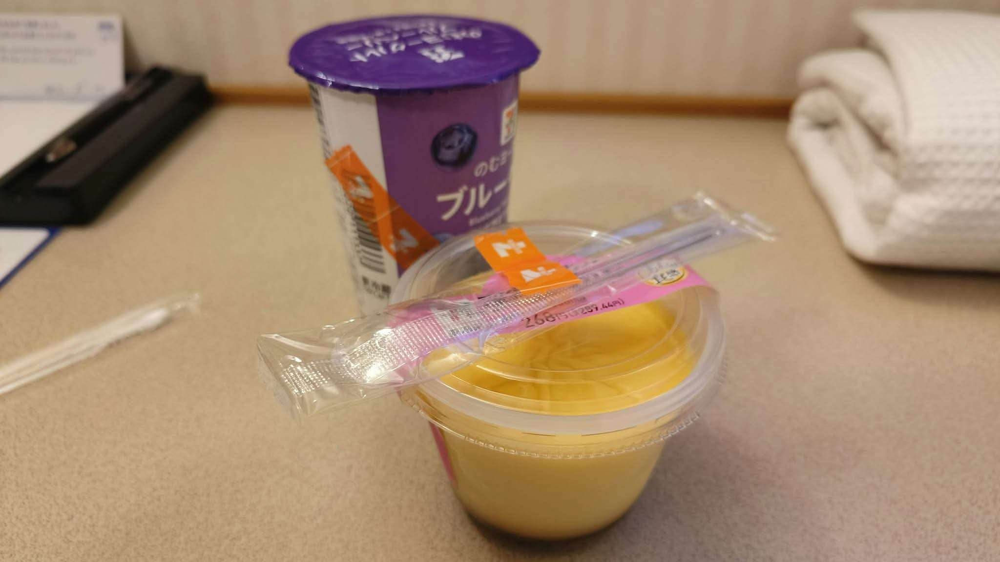

# 餐廳辨識案件

## 案件資訊

- 案件編號：029
- 建立日期：2026-10-22
- 照片／線索：Discord 頻道由 water200427 上傳之照片
- 目前狀態：已結案（判定為超商外帶食品於日本商務旅館客房內食用，非實體餐廳內用）

## 使用者提供的範圍與限制

- 可能地點：照片物證指向日本（日幣標價、日文商品、日式商旅設備）
- 指定日期或時間：近期商品
- 其他限制：經排查為超商外帶食品，非實體餐飲店家內用

## 照片觀察

### 餐點

- 可確認：
  1. **前景甜點**：日本 7-Eleven（セブン-イレブン）冷藏甜點「エグパティシエール使用 カスタードプリン」（濃厚布丁）。透明圓杯，杯口以日本 7-Eleven 經典橘色商標膠帶固定了一支透明外包裝塑膠湯匙。杯蓋封膜印有明確價格「268円(税込289.44円)」以及雞蛋造型標章「エグパティシエール」（Égupatissier，日本 7-Eleven 專用高等級烘焙專用蛋品牌）。
  2. **背景飲品**：日本 7-Eleven 自有品牌 7-Premium（セブンプレミアム）之「のむヨーグルト ブルーベリー 190g」（藍莓優酪乳／喝的優格）。紫色杯蓋印有白字「のむヨーグルト」，杯身印有「7&i」控股企業標章、藍莓果實圖樣以及日文品名「ブルーベリー」，側面同樣黏有日本 7-Eleven 橘色封口膠帶。
- 推測、待確認：
  - 布丁全名為日本 7-Eleven 常態販售之「とろけるカスタードプリン」或「窯出しプリン」系列改版品。

### 餐具與器皿

- 器皿為便利商店一次性塑膠杯與工廠封膜，非餐廳重複使用之內用餐具。
- 附帶之餐具為超商結帳附贈之透明塑膠湯匙，以印有 7 標誌的橘色窄版膠帶黏附於杯蓋。

### 餐廳環境（實際為飯店客房）

- **桌面**：米色／淺灰色細微顆粒之防火美耐板桌面，邊緣帶有木質收邊線條，為日本商務飯店客房辦公書桌之標準建材。
- **背景右側**：整齊折疊放置的白色乾淨純棉浴巾（大浴巾與毛巾），上方堆疊著一件米白色蜂巢織紋（Waffle weave）連身睡袍／浴衣，此為日本商務連鎖飯店（如 Super Hotel、Dormy Inn、Daiwa Roynet、相鐵 Fresa Inn 等）客房內之典型標準配置。
- **背景左側**：直立放置之白色客房服務指南／須知卡片，以及黑色長條型便條紙座／遙控器插座。
- **結論**：照片拍攝場景非任何實體餐廳或咖啡廳，而是日本商務旅館／飯店客房內部，照片中食物係住客自日本 7-Eleven 門市購入後攜回客房享用之點心。

## 使用者後續補充或更正

- 來自 Discord 訊息 ID: 1562822194109747340

## 候選店家排查

| 店名 | Google Maps 地點 | 餐點符合處 | 環境／器皿符合處 | 不符合處 | 近期營業證據 | 判斷 |
| --- | --- | --- | --- | --- | --- | --- |
| 日本 7-Eleven（セブン-イレブン 全國各門市） | 全日本各分店通用零售（無特定單一店家） | 完全吻合（エグパティシエール 268円布丁、7-Premium 藍莓優格飲、7-11 橘色膠帶） | 符合（超商零售包裝與超商專用湯匙） | 非實體餐廳內用，拍攝地點為飯店房間 | 全日本 2 萬家以上門市常態營業販售中 | **確定為超商外帶食品（非餐廳）** |

## 結論

- **店名**：非實體餐廳（日本 7-Eleven 超商外帶食品／日本商務飯店客房內食用）
- **Google Maps 地點**：無（依《找餐廳判斷規則》第 7 條特別規範，確認為非餐廳或超商外帶手作/客房食用者，大膽斷定結案，不附上 Google Maps 連結）
- **把握度**：極高（物證 100% 吻合）
- **主要依據**：
  1. 前景布丁直接印有價格「268円(税込289.44円)」與日本 7-Eleven 獨家甜點專用蛋標籤「エグパティシエール」。
  2. 背景優酪乳印有日本 7-Eleven「7&i」品牌商標與「のむヨーグルト ブルーベリー」。
  3. 兩者均黏有日本 7-Eleven 專用橘色 7 商標膠帶與超商塑膠匙。
  4. 背景陳設為日本商務飯店客房標準配備（蜂巢織紋睡袍、白色浴巾、飯店說明手冊）。
- **尚未確認之處**：
  - 具體購買之 7-Eleven 分店與入住飯店名稱（超商食品全日本各門市皆有販售，無需亦無法指定特定分店）。

### 餐點品項與價位試算

- 參考來源：日本セブン-イレブン（7-Eleven Japan）官方商品情報與近期定價
- 價目表日期：2026 年
- 幣別：日圓 (JPY)

| 辨識品項 | 規格／數量 | 單價 | 小計 | 照片依據與備註 |
| --- | --- | --- | --- | --- |
| セブン-イレブン エグパティシエール使用 カスタードプリン | 1 杯 | 268 円（税込 289 円） | 289 円 | 杯蓋封膜印刷「268円(税込289.44円)」，超商外帶適用輕減稅率 8% |
| セブンプレミアム のむヨーグルト ブルーベリー | 190g / 1 杯 | 170 円（税込 183 円） | 183 円 | 7-Premium 常態藍莓優格飲，超商外帶適用輕減稅率 8% |

- **預估總金額：** 438 円（未稅）／ **472 円（含稅 8%）**
- 費用與低消備註：日本便利商店外帶食品，適用消費稅輕減稅率 8%，無內用服務費與低消限制。
