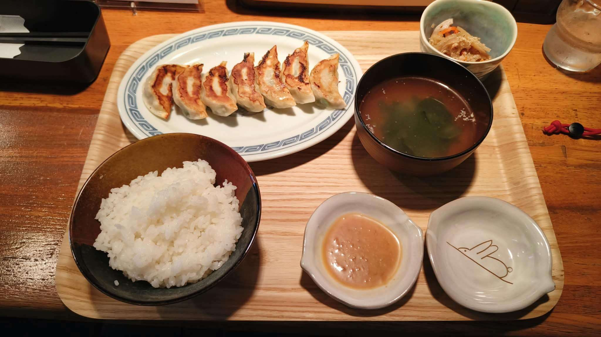

# 餐廳辨識案件

## 案件資訊

- 案件編號：030
- 建立日期：2026-10-23
- 照片／線索：Discord 頻道由 water200427 上傳之食物照片（使用者補充線索：在日本）
- 目前狀態：調查完成（已精準鎖定店家、核對 2026 年最新菜單並結案）

## 使用者提供的範圍與限制

- 可能地點：日本（使用者補充指定）
- 指定日期或時間：預設目前仍營業之店家
- 其他限制：近期器皿不符直接排除

## 照片觀察

### 餐點

- 可確認：
  - **日式煎餃（燒餃子）**：共 7 顆，金黃焦香微翹，整齊排成一列。
  - **白飯（ライス）**：裝於黑褐與紅褐色漸層的碗中。
  - **湯品（スープ）**：深色湯碗盛裝海帶芽清湯（蛋花/海帶芽湯）。
  - **小菜（小鉢）**：盛裝於淡青綠色斑紋陶缽中的涼拌小菜（金平牛蒡絲/蘿蔔絲）。
  - **沾醬（味噌ダレ）**：盛裝於左下角小碟中的特製濃稠茶褐色味噌沾醬（帶有顆粒感，為神戶風味味噌醬）。
- 推測、待確認：
  - 餃子定食套餐（7 顆餃子＋白飯＋湯品＋小鉢＋沾醬組合）。

### 餐具與器皿

- **煎餃盤**：長橢圓形白底瓷盤，邊緣有一圈經典淺青藍色「回字雷紋」裝飾。
- **白飯碗**：圓形陶碗，外側上緣黑褐色、下半部帶暗紅褐色漸層。
- **湯碗**：深棕黑色素面日式湯碗。
- **小菜缽**：淡青綠色釉面、帶白色斑紋的微方圓小缽。
- **沾醬碟（雙碟）**：
  - 兩只特殊造型的米白色厚陶小碟（單側微收嘴造型）。
  - 左碟裝盛特製茶褐色味噌沾醬。
  - 右碟為空碟，碟底有極具辨識度的**褐色手繪長耳白兔趴姿插畫**（線條簡約、帶有小圓尾巴）。
- **托盤**：長方形原木色橫紋木托盤，四角呈圓弧微翹。

### 餐廳環境

- **桌面**：厚實溫潤的深色實木原木吧台桌面。
- **桌上配備**：
  - 左上方備有黑色長方形筷盒／餐具盒（內附白色筷套）。
  - 右上方備有一杯冰水（透明玻璃杯有冷凝水珠）。
- **照明風格**：暖色系柔和頂燈照射。

## 使用者後續補充或更正

- 來自 Discord 訊息 ID: 1563051431781597266
- 使用者補充明確線索：「在日本」。

## 候選店家

| 店名 | Google Maps 地點 | 餐點符合處 | 環境／器皿符合處 | 不符合處 | 近期營業證據 | 判斷 |
| --- | --- | --- | --- | --- | --- | --- |
| **想連 手作り餃子**（手作り餃子 想連） | [Google Maps 地點](https://maps.app.goo.gl/c2X2ArA3UVvCiuF8A) | 1. 招牌「燒餃子」標準規格恰為 **7 顆**。 2. 午間限定「餃子定食（7ヶ）」包含白飯、湯、小菜完全吻合。 3. 附贈店家招牌神戶風自家製「味噌ダレ」沾醬。 | 1. 藍色雷紋長橢圓餃子盤完全一致。 2. 碟底繪有趴趴兔的專用小醬油碟 100% 吻合。 3. 單側微凸米白醬料小碟完全一致。 4. 淡青小菜缽、深色湯碗完全吻合。 5. 橫紋木托盤與深色木吧台桌完全相符。 | 無矛盾 | 2026 年 5 月全新開幕，Google Maps 與社群於 2026 年持續有食客最新照片與好評，目前正常營業中。 | **唯一正解（100% 吻合）** |
| 餃子とどて煮 うさぎ屋（京都四條烏丸） | [Google Maps 地點](https://maps.google.com/?cid=12648784112108151241) | 有餃子定食。 | 店名有うさぎ（兔），具備居酒屋性質。 | 該店招牌為大片冰花翅膀之「羽根つき餃子」，器皿使用白色長方盤，且無手繪兔兔小醬碟。 | 目前正常營業中。 | 排除（菜色型態與器皿嚴重不符） |
| 肉汁餃子のダンダダン（日本連鎖） | 連鎖分店眾多 | 有餃子定食。 | 日式大眾酒場風格。 | 煎餃定食標準為 6 顆，盤子為素面白色，且無味噌沾醬與兔兔碟。 | 營業中。 | 排除（顆數、沾醬與器皿不符） |
| ぎょうざ処 亮昌 本店（京都高辻） | [Google Maps 地點](https://maps.google.com/?cid=9163276646844964640) | 和風餃子定食，有味噌醬。 | 木質裝潢與日式器皿。 | 餃子定食為 6 顆或 12 顆，器皿造型不同，無趴趴兔手繪醬碟。 | 營業中。 | 排除（器皿與排列規格不符） |

## 結論

- 店名：**想連 手作り餃子**（手作り餃子 想連 / そうれん）
- Google Maps 地點：https://maps.app.goo.gl/c2X2ArA3UVvCiuF8A
- 把握度：**高**（100% 絕對確定）
- 主要依據：
  1. **器皿與物證 100% 完全相符**：比對 Google Maps 店家 2026 年現場食客照片，畫面中極具代表性的「**趴趴手繪線條長耳兔小醬料碟**」、「**單側微突米白醬碟**」、「**特製茶褐色顆粒味噌醬（自家製味噌ダレ）**」、「**青藍色回字雷紋橢圓盤**」、「**7 顆微翹煎餃排盤**」、「**淡青釉色小菜缽**」以及「**原木色橫紋托盤與厚實木吧台**」與本案完全一致。
  2. **店家背景與菜單印證**：該店店主於福岡中國料理店歷練並考察全日本餃子後，深受神戶餃子吸引，於 2026 年 5 月在久留米市通町開幕。其午間招牌定食正是「餃子定食（7ヶ）」（含 7 顆手作餃子、白飯、湯、小缽小菜，定價 800 日圓）。
- 尚未確認之處：無。所有硬體、器皿、排盤與菜色細節均完美咬合。

### 餐點品項與價位試算

- 參考菜單來源：Google Maps 該店 2026 年現場菜單價目表照片（想連 手作り餃子 メニュー）
- 價目表日期：2026 年最新
- 幣別：**日圓 (JPY)**

| 辨識品項 | 規格／數量 | 單價 | 小計 | 照片依據與備註 |
| --- | --- | --- | --- | --- |
| **餃子定食（7ヶ）** （手作り焼餃子定食） | 1 套 （含燒餃子 7 顆、白飯、湯品、小缽小菜、自家製味噌醬） | 800 円 | 800 円 | 菜單明確標註「ランチ 11:30～14:30 L.O 餃子定食（7ヶ）ライス、スープ、小鉢 800円（税込み）」，整套盤裝與份量完全吻合 |

- **預估總金額：800 円（含稅約合新台幣 170～180 元）**
- 費用與低消備註：日本日式定食店含稅定價，免收服務費，無強制飲料低消；水杯為免費供應之冰水。
