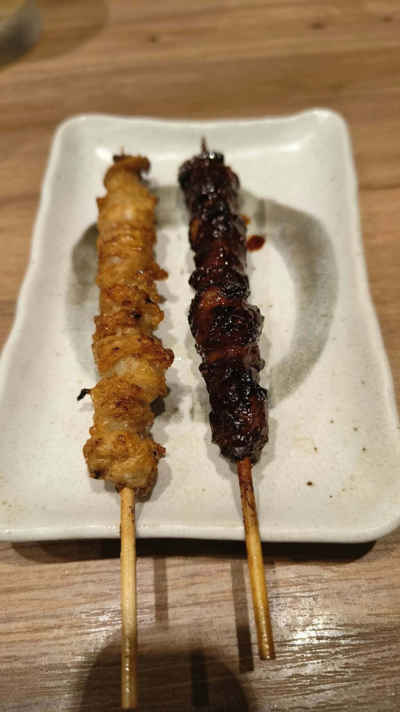

# 餐廳辨識案件

## 案件資訊

- 案件編號：032
- 建立日期：2026-10-23
- 照片／線索：Discord 頻道由 water200427 上傳之食物照片
- 目前狀態：調查中（已轉交 Antigravity 深度微型物證排查）

## 使用者提供的範圍與限制

- 可能地點：依規則預設（台北、桃園、台南），必要時擴大
- 指定日期或時間：預設目前仍營業之店家
- 其他限制：近期器皿不符直接排除

## 照片觀察

### 餐點

- 可確認：
- 推測、待確認：

### 餐具與器皿

- 碗／盤／托盤的顏色、材質、形狀、花紋：

### 餐廳環境

- 桌面、牆面、風扇、座椅、照明、擺設及空間：

## 使用者後續補充或更正

- 來自 Discord 訊息 ID: 1563154544261865543

## 候選店家

| 店名 | Google Maps 地點 | 餐點符合處 | 環境／器皿符合處 | 不符合處 | 近期營業證據 | 判斷 |
| --- | --- | --- | --- | --- | --- | --- |

## 結論

- 店名：
- Google Maps 地點：
- 把握度：低／中／高
- 主要依據：
- 尚未確認之處：

### 餐點品項與價位試算

- 參考菜單來源：（如：Google Maps 2026年最新菜單照片／店家官方價目表）
- 價目表日期：（如：2026 年）
- 幣別：新台幣 (TWD)

| 辨識品項 | 規格／數量 | 單價 | 小計 | 照片依據與備註 |
| --- | --- | --- | --- | --- |

- **預估總金額：**
- 費用與低消備註：（如：免收服務費／內用需加收 10% 服務費／無低消限制）
