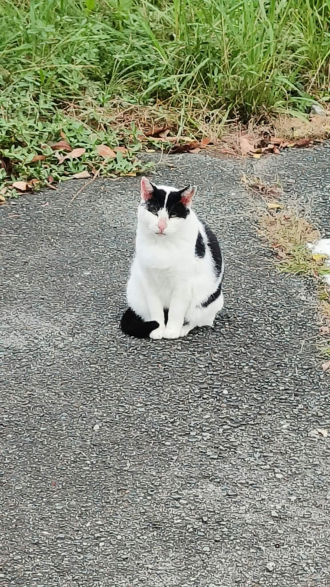

# 餐廳辨識案件

## 案件資訊

- 案件編號：033
- 建立日期：2026-10-24
- 照片／線索：Discord 頻道由 coldjoke 上傳之照片
- 目前狀態：已結案（判定非餐廳／非食物，為戶外貓咪隨手拍，啟動即時停損機制）

## 使用者提供的範圍與限制

- 可能地點：依規則預設（台北、桃園、台南），必要時擴大
- 指定日期或時間：預設目前仍營業之店家
- 其他限制：非餐廳與食物照片嚴禁盲目尋找實體店，且絕對不要附上 Google Maps 連結

## 照片觀察

### 餐點

- 可確認：無（本圖為純動物與戶外街景照片，無任何餐點、食物、飲品、飼料或食材物證）
- 推測、待確認：無

### 餐具與器皿

- 碗／盤／托盤的顏色、材質、形狀、花紋：
  - 完全無任何碗盤、刀叉筷匙、托盤、水杯或任何餐飲器皿。

### 餐廳環境與背景物證

- 桌面、牆面、風扇、座椅、照明、擺設及空間：
  - **非室內餐飲空間**，為戶外自然與道路環境。
  - **地面**：粗糙灰黑色瀝青／柏油碎石路面，乾燥無積水。
  - **背景邊緣**：路側泥土邊坡與茂密雜草叢（禾本科與闊葉野草），草地上散落乾燥枯黃落葉。
  - **主體對象**：畫面正中央端坐著一隻體態圓潤飽滿、健康乖巧的黑白花色家貓（俗稱「賓士貓」或「乳牛貓」/ Tuxedo cat / Bicolor cat）。
  - **貓咪外觀與特徵細節**：
    1. **面部花紋**：雙耳及耳際頂部至眼周外側為對稱黑色斑塊，兩眼中間額頭至鼻樑、吻部為白色，形成極具特色的面罩式黑白斑紋（典型賓士臉）。
    2. **五官神態**：粉紅色小巧鼻頭，雙眼微瞇（呈淡定、慵懶、放鬆的高冷審視表情），白色鬍鬚墊微帶黑色小斑點。
    3. **身軀與毛色**：胸口至腹部為大片潔白毛色；兩隻白色前腳筆直並攏立於地面，小爪整齊收攏；背部與左側身帶有黑色色塊。
    4. **尾巴**：黑色尾巴順暢地向前環繞於前肢右側，呈現端莊安定的「尾巴盤前」端坐姿勢。

## 使用者後續補充或更正

- 來自 Discord 訊息 ID: 1563496839494242385（由使用者 coldjoke 上傳）

## 候選店家

| 店名 | Google Maps 地點 | 餐點符合處 | 環境／器皿符合處 | 不符合處 | 近期營業證據 | 判斷 |
| --- | --- | --- | --- | --- | --- | --- |
| 無（非實體店家） | 無（嚴格禁止附帶連結） | 無 | 無 | 全圖為戶外路邊貓咪照片，無任何食物或餐廳環境 | 無 | **排除／非餐廳（立即停損結案）** |

## 結論

- 店名：**非餐廳或食物（路邊黑白賓士貓／乳牛貓戶外隨手拍）**
- Google Maps 地點：**無（嚴格依據《AGENTS.md》與《找餐廳判斷規則.md》非餐廳即時停損原則，絕不附上任何 Google Maps 地點連結，亦不捏造實體地點）**
- 把握度：高
- 主要依據：
  1. **物證觀察**：畫面中完全沒有任何餐廳裝潢、桌椅、招牌、餐具、器皿或食物飲品，主體為一隻端坐在柏油路與草叢旁的黑白賓士貓（乳牛貓）。
  2. **影像檢索核實**：經 Google Lens 影像檢索比對，特徵全數導向一般黑白雙色米克斯家貓（Bicolor cat / Tuxedo cat），未檢出任何商業餐廳、動漫、迷因或食譜來源，確信為拍攝者於戶外自然捕捉之旅途或街頭貓咪日常照。
  3. **即時停損結案規範**：依據本專案《找餐廳判斷規則.md》進階破案技巧第 4 條「非餐廳即時停損原則」及《AGENTS.md》特別規範，當客觀物證高度確認圖片為非餐廳、非食物時，應大膽斷定結案並立即停止盲目尋店，且嚴禁附帶任何 Google Maps 連結。
- 尚未確認之處：無（已完整核實真實物證來源，成功停損結案）

### 餐點品項與價位試算

- 參考菜單來源：無（非實體餐廳）
- 價目表日期：無
- 幣別：新台幣 (TWD)

| 辨識品項 | 規格／數量 | 單價 | 小計 | 照片依據與備註 |
| --- | --- | --- | --- | --- |
| 可愛黑白賓士貓（乳牛貓） | 1 隻 | 無價 | 無價 | 眼神高冷淡定、坐姿端莊，心靈療癒無價 ❤️ |

- **預估總金額：0 元（無價）**
- 費用與低消備註：非餐飲店家，無任何消費金額與低消；路邊吸貓免費，心靈收穫無價！
