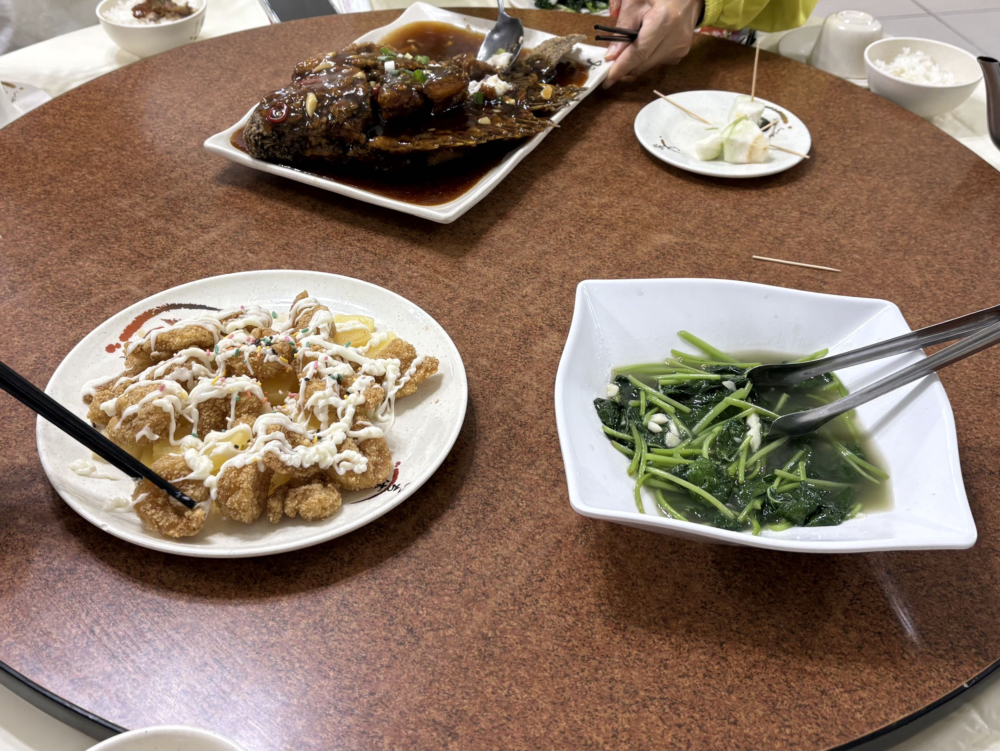
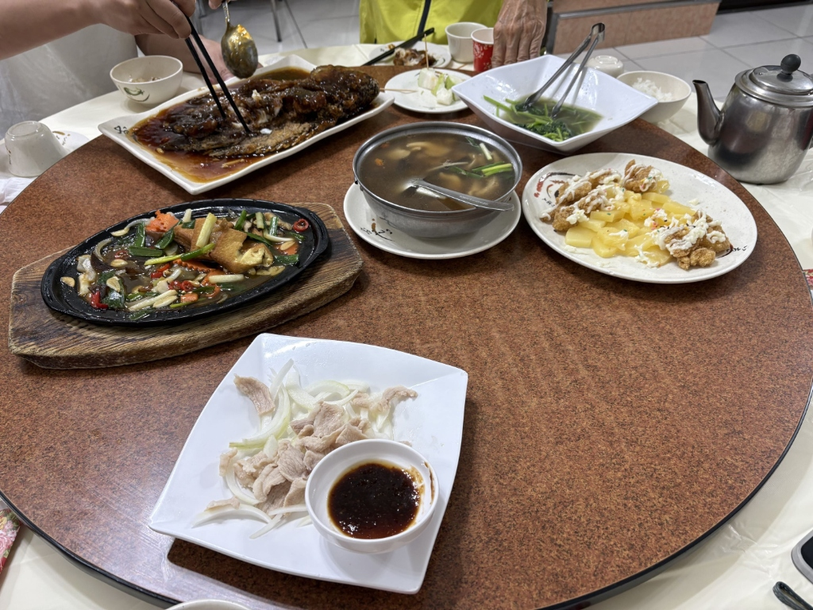

# 餐廳辨識案件

## 案件資訊

- 案件編號：037
- 建立日期：2026-10-25
- 照片／線索：Discord 頻道由 coldjoke 上傳之食物照片（後續於對話中補充更廣角之全景合菜照片）
- 目前狀態：調查完成（已鎖定目標店家）

## 使用者提供的範圍與限制

- 可能地點：依規則預設（台北、桃園、台南），後續物證鎖定桃園龍潭石門活魚商圈
- 指定日期或時間：預設目前仍營業之店家
- 其他限制：器皿與環境不符直接排除

## 照片觀察

### 餐點

- **可確認**：
  1. **糖醋松鼠魚／糖醋活魚**：整尾肥碩鮮魚，施以精湛直深切刀工（或開花刀），高溫油炸至外皮金黃焦香酥脆、魚肉微翻呈立體扇狀，內部魚肉雪白細嫩；淋上深黑褐色濃郁微稠之古法酸甜糖醋醬汁，佐以蔥花、蒜末與辣椒圈。
  2. **鳳梨蝦球**：大顆酥炸裹粉蝦仁，金黃酥脆，擠上波浪狀甜美乃滋，表面撒上極具台灣傳統熱炒特色之「五彩巧克力米／糖珠」，底層鋪滿切片鳳梨片。
  3. **鐵板豆腐**：橢圓形黑色生鐵烤盤配長方形隔熱木底座，主角為油煎金黃外酥內嫩之雞蛋豆腐切塊，佐以紅蘿蔔花片、洋蔥絲、青蔥段、辣椒片與九層塔葉，淋上黑胡椒鐵板醬汁高溫拌炒。
  4. **蒜泥白肉**：薄切汆燙熟透之五花／梅花豬肉片，整齊鋪滿於一層清脆生洋蔥絲上，附白色圓形小沾醬碟盛裝濃稠特調蒜蓉醬油膏。
  5. **蒜炒地瓜葉（季節時蔬）**：炒得翠綠油亮，湯汁清爽帶蒜粒，上方附有一把不鏽鋼金屬分菜食物夾。
  6. **養生百菇清湯**：單柄耳鋁質小湯鍋，盛放於圓形陶盤底座上，湯頭清甜甘醇，內有秀珍菇／杏鮑菇、枸杞、青蔥段與排骨／肉片。
  7. **餐後四季水果盤（招待芭樂）**：切塊新鮮芭樂，插有三根木質牙籤，盛於專用小骨碟。
  8. **香蔥雞油拌飯／白飯**：左上角小碗盛裝淋有深色油亮蔥油醬汁之自製拌飯（店內招牌自助無限續）。
  9. **茶水**：不銹鋼金屬熱茶壺與傳統紅色雙喜／喜慶圖案免洗紙杯。

### 餐具與器皿

- **全套系列美耐皿／陶瓷**：
  - 鳳梨蝦球圓盤、水果小碟、湯鍋托盤、小飯碗皆為統一之「米白底細沙斑點＋紅褐墨印＋黑色草書毛筆墨跡」商業餐具系列。
  - 糖醋魚盤：白色厚瓷長方形微波浪翹角深平盤，邊緣帶有黑色書法筆觸。
  - 炒地瓜葉盤：白色特殊四方形微凹深盤，四角微揚。
  - 蒜泥白肉盤：白色正方形平盤，四邊微翹。
  - 分菜餐具：地瓜葉盤附不銹鋼食物夾、魚盤附大不銹鋼分菜匙。

### 餐廳環境

- **桌面**：大圓桌，中央配備直徑較大之深紅棕色細石斑紋美耐皿旋轉圓盤（轉盤邊緣帶黑色防撞膠邊），底桌鋪設白色桌巾。
- **地面與室內**：地面為明亮潔淨之大塊白色拋光石英磚；後方設有木質暖橘色矮隔斷屏風，頂部裝設金屬銀色收邊條。

## 使用者後續補充或更正

- 來自 Discord 補充提示（訊息 ID: 1563873718437023827）：你開啟新對話異常，可以嘗試修正嗎？
- 來自 Discord 訊息 ID: 1563872342306848893 上傳之原始照片。
- 使用者於對話中補充上傳同一餐桌更廣角之全景照片，完整揭露鐵板豆腐、蒜泥白肉、百菇湯品與地面、隔屏等全套環境物證。

## 候選店家

| 店名 | Google Maps 地點 | 餐點符合處 | 環境／器皿符合處 | 不符合處 | 近期營業證據 | 判斷 |
| --- | --- | --- | --- | --- | --- | --- |
| **好客人家餐館** | [Google Maps 地點](https://maps.app.goo.gl/jeuAURoNroWqGV2J7) | 1. 招牌「糖醋松鼠魚（活魚）」深色醬汁與刀工完全吻合 2. 招牌鳳梨蝦球撒五彩巧克力米 3. 鐵板豆腐、蒜泥白肉、季節時蔬、養生湯品完全相符 4. 免費自製「雞油／香蔥醬油拌飯」完全吻合左上角肉燥油蔥飯 5. 附贈四季水果盤（芭樂插牙籤） 6. 知名「六菜一湯 1,500 元」組合完全吻合 | 1. 旋轉圓桌（深紅棕細石斑紋轉盤＋白桌巾）吻合 2. 全套白底墨痕美耐皿系列餐具吻合 3. 白色拋光石英磚地面吻合 | 無明顯矛盾；平日多採預約或以粉專公告為主 | 2026年最新營業評論與 Google Maps 營業中狀態（4.3星，1,015則評論） | **最可能目標店家（完全吻合）** |
| **石園活魚餐廳 (文化分店)** | [Google Maps 地點](https://maps.google.com/?cid=5062719299496018687) | 1. 招牌糖醋活魚亦採用深褐色酸甜醬汁 2. 單點有鳳梨蝦球、青菜 | 1. 圓桌旋轉盤與茶壺類似 | 1. 石園活魚多使用大橢圓紅金描邊瓷盤 2. 無提供免費自製雞油拌飯吃到飽 3. 無 1500 元六菜一湯客家特色平價組合 | 2026年正常營業中 | 排除（器皿型態與店內自助飯食不符） |
| **名佳鄉料理** | [Google Maps 地點](https://maps.google.com/?cid=13063529367448834458) | 有鳳梨蝦球、鮮魚熱炒 | 白色石英磚地面、旋轉大圓桌 | 主力招牌為白斬玉米雞、芋頭米粉，非石門活魚糖醋全魚風格，無自製雞油飯 | 2026年正常營業中 | 排除（菜系主力與特色不符） |
| **滿味平價快炒** | [Google Maps 地點](https://maps.google.com/?cid=12686150244199173926) | 有熱炒、白飯自取、鳳梨蝦球 | 平價熱炒店 | 為街邊百元快炒店，無鋪白桌布大圓桌、無招待切塊水果、無整條糖醋活魚盛宴配置 | 2026年正常營業中 | 排除（用餐業態與環境不符） |

## 結論

- **店名**：好客人家餐館（Google Maps 標示：好客人家餐館(以粉專公告為主)）
- **Google Maps 地點**：[https://maps.app.goo.gl/jeuAURoNroWqGV2J7](https://maps.app.goo.gl/jeuAURoNroWqGV2J7)
- **地址**：325 桃園市龍潭區佳安里十一分路199-1號（近石門派出所、十一份觀光文化園區週邊）
- **電話**：03-471-2202
- **把握度**：高
- **主要依據**：
  1. **招牌特色料理完全相符**：深油炸整尾開刀紋的「糖醋松鼠魚（活魚）」搭配獨門深黑褐色酸甜糖醋醬，完全符合該店招牌烹調特色；佐以台式懷舊灑巧克力米「鳳梨蝦球」、「鐵板豆腐」、「蒜泥白肉」與「養生百菇清湯」。
  2. **靈魂物證——自製香蔥雞油拌飯**：照片左上角出現的油亮肉燥油蔥飯，精準對應好客人家餐館最知名且廣受老饕推崇的「自製香蔥雞油與醬油拌飯免費無限吃到飽」貼心服務。
  3. **餐具與器皿完全吻合**：鳳梨蝦球盤、芭樂水果骨碟、湯鍋托盤與飯碗皆採用同款「白底細斑＋水墨草書與紅褐墨印」餐具；魚盤、青菜深盤及附上的不鏽鋼夾亦完全一致。
  4. **用餐環境**：深棕紅細石斑旋轉圓盤、底層白桌巾、大塊白色拋光石英磚地面與木質隔斷裝潢完全吻合。
  5. **經典合菜組合**：此桌「六菜一湯（含招待水果）」正是好客人家餐館風靡網路的經典平價合菜配置。
- **尚未確認之處**：平日到訪建議先致電確認是否營業（目前多以週末為主或需提前預約）。

### 餐點品項與價位試算

- 參考菜單來源：好客人家餐館官方粉絲專頁、Google Maps 最新菜單照片與現場經典合菜價目
- 價目表日期：2025～2026 年
- 幣別：新台幣 (TWD)

| 辨識品項 | 規格／數量 | 單價 | 小計 | 照片依據與備註 |
| --- | --- | --- | --- | --- |
| 糖醋松鼠魚（糖醋活魚） | 1 尾（整條大份） | $500 | $500 | 店家招牌活魚料理，深切花刀油炸淋深醬色糖醋汁 |
| 鳳梨蝦球 | 1 盤（標準份量） | $250 | $250 | 炸蝦球配鳳梨片、美乃滋與五彩巧克力米 |
| 鐵板豆腐 | 1 份（黑生鐵烤盤） | $200 | $200 | 雞蛋豆腐、九層塔、洋蔥黑胡椒鐵板燒 |
| 蒜泥白肉 | 1 盤（佐洋蔥絲） | $200 | $200 | 汆燙五花肉薄片鋪生洋蔥，附蒜蓉油膏 |
| 蒜炒季節時蔬（地瓜葉） | 1 盤（附金屬食物夾） | $150 | $150 | 蒜粒清炒翠綠地瓜葉 |
| 養生百菇清湯 | 1 鍋（單柄耳鋁鍋） | $200 | $200 | 秀珍菇、青蔥、枸杞與排骨清燉 |
| 自製香蔥雞油拌飯／白飯 | 多碗（自助取用） | $0 | $0 | 店內用餐提供雞油拌飯、白飯無限享用 |
| 四季水果盤（鮮切芭樂） | 1 碟（插牙籤） | $0 | $0 | 餐後店家招待之當季新鮮水果切塊 |
| 熱茶招待 | 1 壺（不鏽鋼壺） | $0 | $0 | 用餐附贈熱茶，附免洗紙杯 |

- **預估總金額：$1,500 元**（若直接點用店家經典「平價超值六菜一湯」合菜套餐，套餐優惠價恰為 **$1,500 元**；若採單點加總約 $1,450～$1,550 元）。
- **費用與低消備註**：**免收 10% 服務費**、無硬性低消限制；白飯與雞油拌飯無限自取，停車場免費。
